<p align="center">
  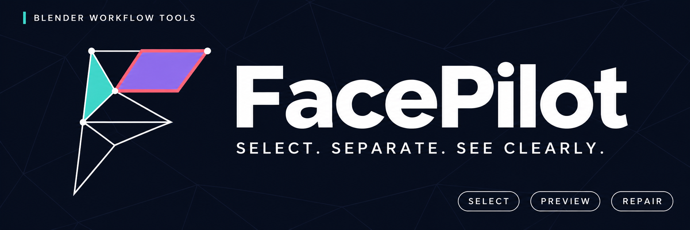
</p>

<p align="center">
  <strong>Precise face selection. Clear material boundaries. Controlled mesh repairs.</strong><br>
  A Blender companion for cleaning up material assignments before texturing.
</p>

<p align="center">
  <a href="README.md"><strong>English</strong></a> ·
  <a href="README.tr.md"><strong>Türkçe</strong></a> ·
  <a href="dist/FacePilot-1.11.0.zip">Download v1.11.0</a> ·
  <a href="docs/SHORTCUTS.md">Shortcut reference</a> ·
  <a href="docs/DEVELOPMENT.md">Development & tests</a>
</p>

<p align="center"><code>Blender 5.2.3 LTS tested</code> &nbsp; <code>TR/EN UI</code> &nbsp; <code>No extra packages</code> &nbsp; <code>GPU-only previews</code></p>

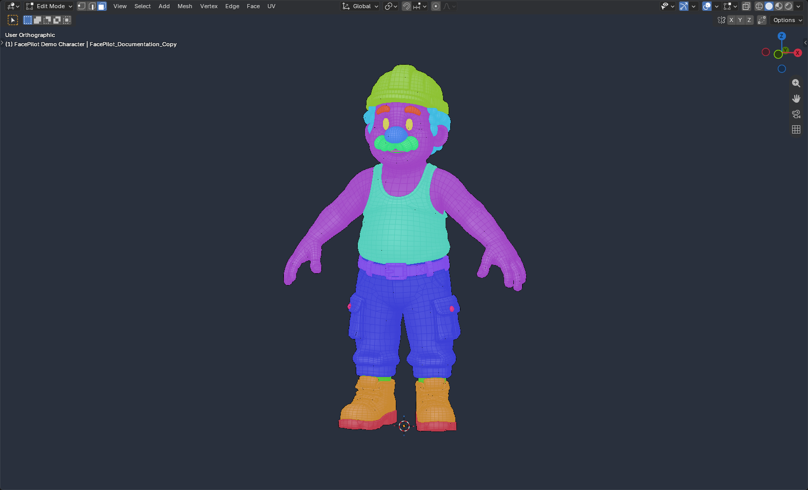

*One click, sixteen materials, sixteen temporary colors. The actual shaders stay intact.*

## Why FacePilot?

You select the belt, discover a few trouser faces belong to it, and need to fix those faces without losing your place. FacePilot puts material selection, temporary visual separation, correction marks and explicit reassignment in one sidebar. It also lists open mesh boundaries and can patch suitable small holes.

The project name is **FacePilot**. The installed add-on retains the name **Kolay Malzeme TR** and module `kolay_malzeme_tr.py`. Since v1.9 its sidebar has independent **Türkçe / English** options. The workflows below quote Turkish controls; the language table maps the main groups to English.

| Workflow | What you get | Changes to the model |
|---|---|---|
| Select & refine | Material selection, smart regions, brush add/subtract, grow/shrink, selection memory | Selection only |
| See clearly | Random material colors, individual colors, four black preview modes | Viewport only |
| Show & hide | Per-material eyes, visible/total counts, isolate/restore | Edit-mesh visibility; faces stay in the mesh |
| Mark & correct | Transparent red correction outlines, toggle/erase/clear | Marking is temporary; **Transfer** changes material assignments |
| Reassign | Move faces to slot 1 or another chosen material; assign/create a material | Real material assignments |
| Remove material | Transfer all its faces to a target and remove its slots from this object | Real assignments and slot removal; geometry is kept |
| Inspect | Open-boundary list, cyan overlay, focus on a listed region | Scan is read-only; focus changes selection/view |
| Repair | Violet Apply/Cancel proposals, strict small-hole filling and selected-vertex welding | Preview is temporary; Apply/fill/weld change geometry |

## Find the right workflow

| I want to… | Go to |
|---|---|
| Find a material's faces, including a tiny leftover group | [Select](#1-select-an-entire-material), [show/hide](#11-material-show--hide--new-in-110), [isolate](#8-isolate-fine-details) |
| Remove a material with one face left | [Remove material](#12-remove-a-material--new-in-111) |
| Deselect excess faces or pick a connected region | [Smart Selection](#2-pick-a-region-with-smart-selection), [refine](#3-refine-and-remember-a-selection) |
| Mark unwanted faces and move them elsewhere | [Red corrections](#4-mark-corrections-in-transparent-red), [target transfer](#5-move-faces-to-a-chosen-material) |
| Distinguish materials before Substance Painter | [Preview colors](#6-give-every-material-a-different-preview-color), [dark masks](#7-darken-distractions-without-painting-the-material) |
| List openings, ignore intentional ones, inspect a patch | [Scan](#9-list-possible-missing-faces-and-openings), [ignore](#91-ignore-openings-you-want-to-keep--new-in-18), [preview repair](#10-preview-a-repair-before-applying-it--new-in-17) |
| Understand Ctrl+Z or recover the view | [Undo and view recovery](#undo-and-view-recovery), [troubleshooting](#troubleshooting) |

## Install in a minute

1. Download [FacePilot-1.11.0.zip](dist/FacePilot-1.11.0.zip). Use the add-on ZIP, rather than GitHub's whole-repository ZIP.
2. In Blender, open **Edit → Preferences → Add-ons → menu → Install from Disk**.
3. Choose the ZIP and enable **Kolay Malzeme TR**. Installing [kolay_malzeme_tr.py](kolay_malzeme_tr.py) directly also works.
4. Select **one mesh**, press **Tab** for Edit Mode, then **N → FacePilot** in the 3D Viewport.

Tested with **Blender 5.2.3 LTS**. The add-on declares Blender 4.2 as its minimum; earlier supported versions have not been validated by this repository's test run. No external Python libraries or service connection are needed.

To update an existing installation, install the latest add-on ZIP through the same menu and restart Blender if the old panel is still loaded. **FacePilot** is the sidebar tab; **Kolay Malzeme TR** is the name to search for in Add-ons.

## Interface & language · new in 1.9

Open **N → FacePilot** and use **Türkçe / English** at the top. This changes the add-on UI, menus, operator tooltips, reports and modal hints without changing Blender's global language or any material/object names. The choice is stored in the add-on's Blender preferences; save preferences manually if automatic preference saving is disabled.

The compact header shows selected/hidden face counts and active material, plus **Isolate / Restore** shortcuts. Each workflow group opens independently. Group IDs stay the same across languages, retaining the current expanded/collapsed state. Real assignment and geometry-editing actions are distinguished from viewport-only controls.

| Türkçe | English |
|---|---|
| Seçim | Selection |
| Akıllı seçim | Smart selection |
| Görsel önizleme | Visual preview |
| Kırmızı düzeltme | Red corrections |
| Malzeme atama | Material assignment |
| Açıklıklar ve onarım | Openings & repair |
| Gelişmiş onarım | Advanced repair |
| Yalıt / Geri göster | Isolate / Restore |

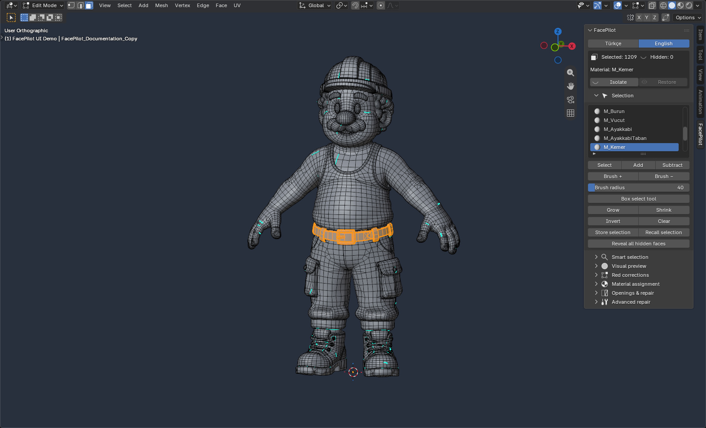

The **Advanced repair** group contains strict small-hole filling and selected-vertex welding. Open **Openings & repair** for scan, ignore/restore and violet patch previews:

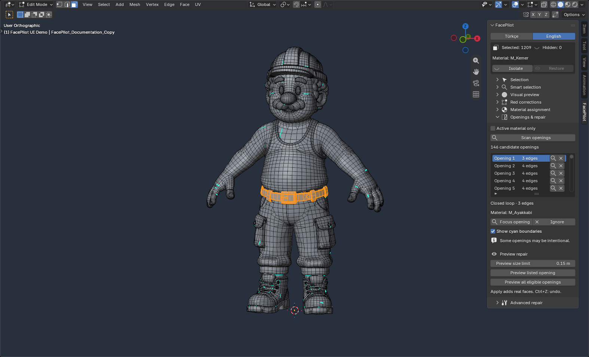

## 1. Select an entire material

Choose a material in **Seçim**, for example `M_Kemer` (belt), then use:

| Button | Result |
|---|---|
| **Seç** | Replace your selection with the visible faces assigned to this material. |
| **Ekle** | Add those faces to your current selection. |
| **Çıkar** | Remove those faces from the selection. Their material stays assigned. |

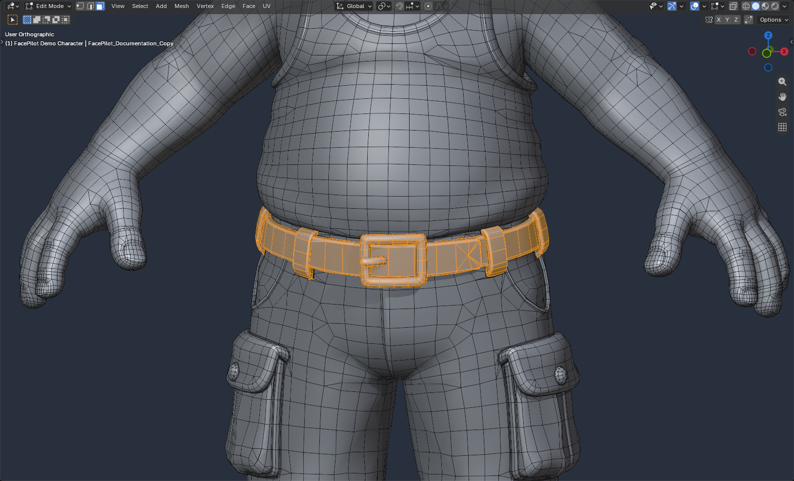

**Deselecting a face and removing it from a material are different actions.** To change its actual assignment, use the transfer tools in section 5.

## 1.1. Material Show / Hide · new in 1.10

Each material row now has an **eye icon** and visible-face count. The active material's **visible / total** count appears below the list. Click an open eye to hide that material's faces; click a closed eye to reveal them. In a partially visible group, the eye hides all of it first. **Göster (Show)** and **Gizle (Hide)** below the list act on the active material.

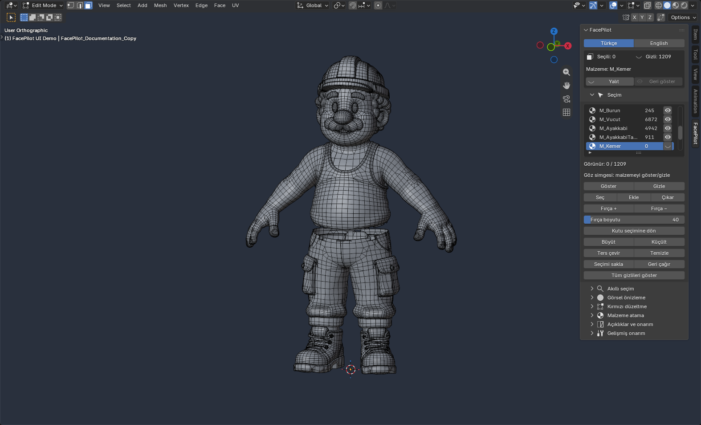

Other materials keep their current visibility. Showing does not select newly revealed faces; hiding deselects hidden faces as Blender normally does. Duplicate slots referencing the same material share one visibility state. This changes edit-mesh visibility, not geometry, UVs or material assignments. **Ctrl+Z** undoes it. Existing isolation can still be restored with **Geri göster (Restore)**; that restores the pre-isolation visibility, including any subsequent eye-button changes. A visibility change clears pending patch previews; rebuild before repair.

## 1.2. Remove a material · new in 1.11

In **Selection**, choose the source material, choose **Removal target** (default: slot 1), then click **Remove material**. Even a single leftover face moves to the target, together with all hidden or unselected faces of that material. Its slots disappear from this object; geometry, UVs, visibility and selection stay intact. Duplicate slots for the same material are removed together. Other objects and the global material datablock are kept.

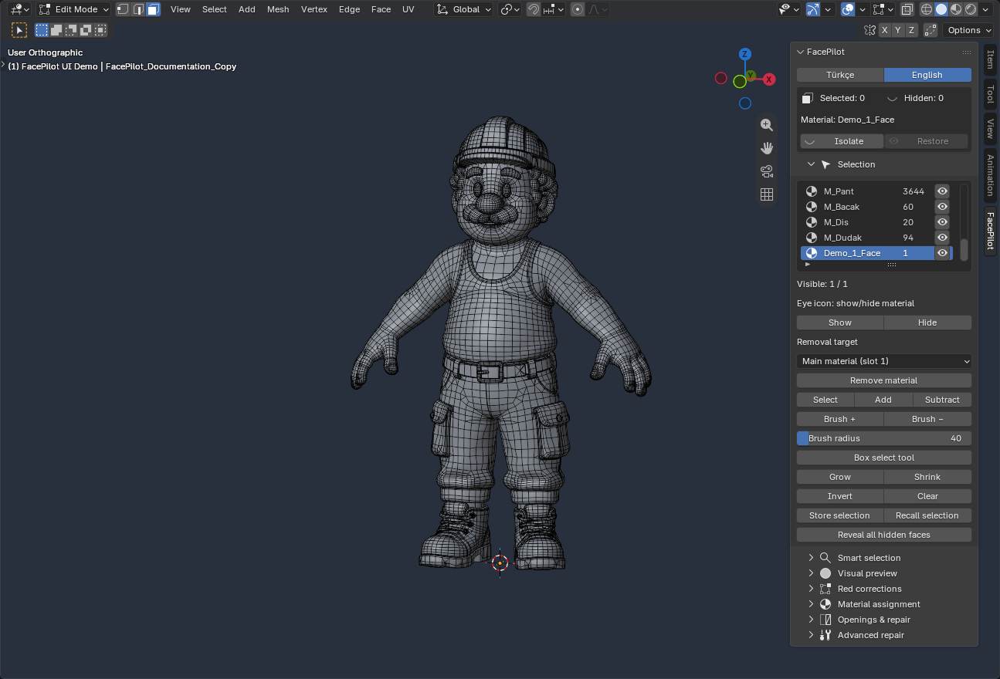

Choose a different target when removing slot 1. Empty materials need no target; a final material with faces needs another material first. Shared mesh data is rejected: make it single-user before removal. A successful removal clears pending repair previews and red marks. **Ctrl+Z** restores slots and assignments together; undo/redo returns Blender to Object Mode, so press **Tab** to resume editing. This command uses full Object Mode undo snapshots because mesh Edit Mode undo does not store material slot arrays.

**Example: a long `tripo_…` material has one face left.** Select its row and check **Visible: 1 / 1** below the list. If it says **0 / 1**, use **Show** first. Press **Select → Isolate** to see where that face belongs; **Restore** brings the surrounding faces back. Choose the destination in **Removal target**, then **Remove material**. If the source is the first slot, choose a different target: “Main material (slot 1)” refers to the list position, not a special material name. **Removal target** and **Material assignment → Target** share the same setting; removal resets it to slot 1 afterward.

| Control | What happens to the source faces/material |
|---|---|
| **Subtract** in Selection | Deselects visible source faces; assignments and slots stay. |
| **Move selected source faces** in Material assignment | Transfers selected visible source faces; source slots stay. |
| **Remove material** in Selection | Transfers every source face, including hidden/unselected faces; removes source slots from this object. |

The original material may still appear in Blender's material picker because its datablock is retained. This button removes its use on the current object; it does not purge materials from the `.blend` file. For shared mesh data, exit Edit Mode and use **Object → Relations → Make Single User → Object & Data**, then return with **Tab**.

## 2. Pick a region with Smart Selection

In **Akıllı seçim**, choose a method, press **Bölgeye tıkla**, then click the mesh.

| Method | How it chooses faces |
|---|---|
| **Otomatik** | Uses an assigned non-first material as a group; on the first material or unassigned faces, uses connected surface boundaries. |
| **Aynı malzeme** | Selects all visible faces sharing the clicked face's material, including disconnected pieces. |
| **Yüzey sınırları** | Follows connected faces within the angle threshold, stopping at material boundaries, seams, sharp edges and hidden faces. |

**Shift-click** adds a region; **Ctrl-click** subtracts it. **Esc** or right-click cancels the picking step. Lower **Açı sınırı** for tighter surface regions; raise it for broader regions.

This is geometry/material-based selection. It does not semantically recognize a belt in an unlabeled mesh, and it cannot correct an incorrect material boundary by itself. The belt screenshot above demonstrates selection of an existing material group.

## 3. Refine and remember a selection

Under **Seçim**:

| Control | Use |
|---|---|
| **Fırça + / Fırça −** | Activate Blender's circle selection tool in add/subtract mode. Adjust **Fırça boyutu**. |
| **Kutu seçimine dön** | Return to the standard box selection tool. |
| **Büyüt / Küçült** | Grow or shrink the current face selection by one step. |
| **Ters çevir / Temizle** | Invert or clear the visible face selection. |
| **Seçimi sakla / Geri çağır** | Store and restore one selection for the current mesh in this session. |

You can also use Blender's normal **B** box, **C** circle and lasso tools. Turn **Alt+Z / X-Ray off** when you want to avoid selecting through the mesh. Selection memory is rejected after topology changes, preventing old face indices from selecting unrelated faces.

## 4. Mark corrections in transparent red

Select the belt first. In **Kırmızı düzeltme**, choose either workflow:

**With normal selection tools:** select the unwanted faces, click **Seçilileri kırmızı işaretle**, and repeat as needed. Select mistakes and click **Seçilileri kırmızıdan çıkar** to unmark them.

**With Ctrl painting:** enable **Ctrl ile kırmızı işaretle**, then **Ctrl + left-click/drag** across selected faces. Clicking a marked face toggles its mark off. A drag follows the first face: start on red to erase, or on unmarked to add. **Ctrl+Shift + left-click/drag** always erases; **Esc** cancels the current stroke.

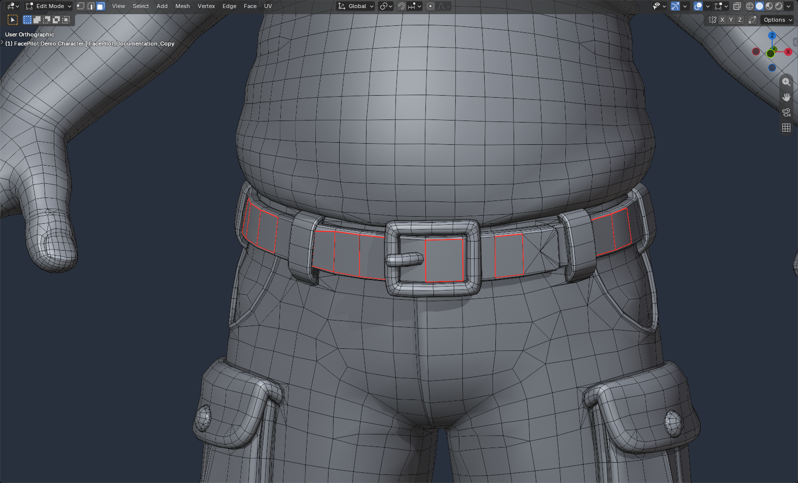

*The ordinary orange selection was cleared for this image to make the persistent red outlines easier to see. Marking initially requires selected, visible faces.*

The fill defaults to **0**, keeping the inside transparent; **İç dolgu** optionally adds tint. Marks accumulate independently of subsequent normal selections. **Clear — tüm kırmızıları iptal et** cancels all marks without changing assignments.

When ready, **İşaretlileri 1. yuvaya taşı** moves marked faces to the **first material slot (internal index 0)** and removes them from the orange selection. This is a real assignment change. The first slot is not necessarily named `M_Vucut`; check your own material order. Use **Ctrl+Z** to undo the transfer.

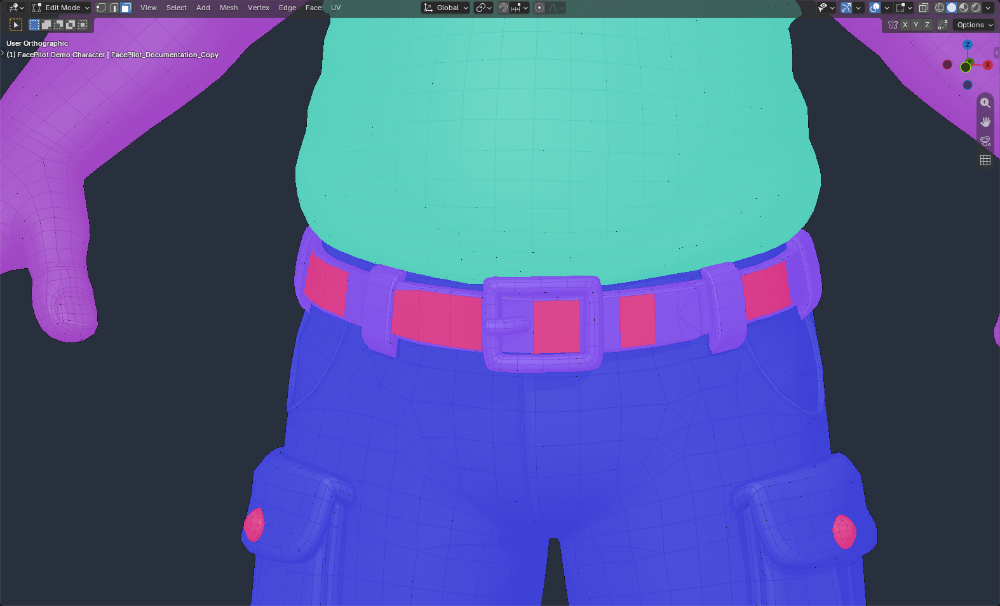

*This transfer was demonstrated only on a disposable copy. Random preview colors make the resulting groups visible.*

Disable the Ctrl checkbox to restore Blender's ordinary Ctrl behavior. Smart Selection's Ctrl-click subtracts a region during its own picking step. Marks reset on topology changes; clear/re-mark if you independently reassign their materials.

## 5. Move faces to a chosen material

In **Malzeme atama**:

1. Select the **source** material in the list, such as `M_Kemer`.
2. Select the faces that should leave it.
3. Set **Hedef** to **Ana malzeme (1. yuva)** or another existing slot, such as `M_Pant`.
4. Click **Seçili yüzleri malzemeden çıkar**.

Only selected, visible faces currently belonging to the source material are transferred. The source material is kept. Matching source/target slots are rejected. This workflow handles any chosen destination; the red transfer button specifically targets the first slot.

For general assignment, use **Malzeme atama → Seçime listedeki malzemeyi ata**. To create one, type its name and choose **Oluştur ve seçime ata**; an existing material with that name is reused. These operations change real assignments and support **Ctrl+Z**.

## 6. Give every material a different preview color

Under **Görsel önizleme**, press **Rastgele renkler**. Every unique material on the active mesh gets a distinct color; repeated slots referencing the same material share its color. No face-by-face selection is needed. Press again to generate another palette.

To color only one material, select it, set **Önizleme rengi** and **Renk yoğunluğu**, then click **Bu malzemeye renk ver**. Apply again after changing the picker. Different materials retain independent preview colors.

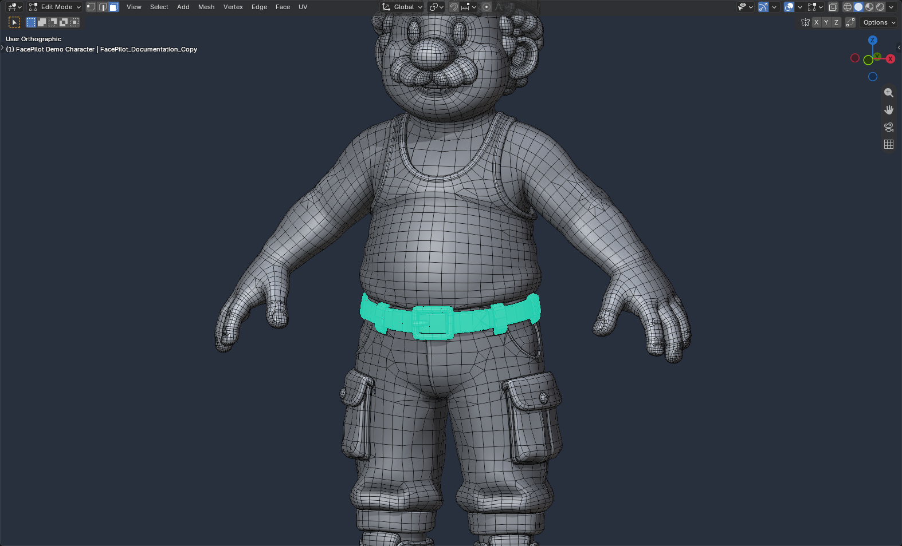

**Rengi kaldır** clears one material; **Renkleri temizle** clears all. **Normal görünüme dön** clears the color previews and black mask. Randomize-all turns the black mask off so the palette can be seen.

## 7. Darken distractions without painting the material

Under **Görsel önizleme → Karartma modu**, choose:

| Mode | What becomes dark |
|---|---|
| **Seçileni karart** | Selected faces |
| **Diğer yüzleri karart** | Faces outside the current selection |
| **Bu malzemeyi karart** | Faces using the active material |
| **Diğer malzemeleri karart** | Faces using all other materials |

Adjust **Karartma** for opacity. **Normal görünüme dön** restores the normal view.

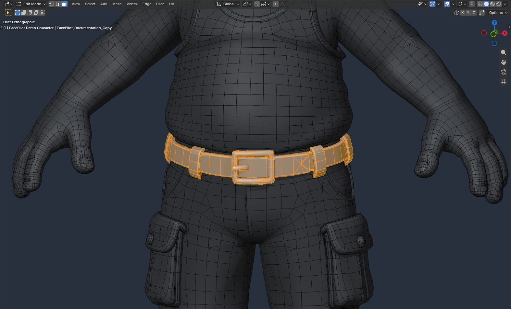

**Preview colors, black masks and red marks are GPU viewport overlays.** They do not change Base Color, shader nodes, texture images, UVs, vertex colors, face material assignments, or export data. They do not appear in renders, bakes, FBX/OBJ/glTF or Substance Painter imports. They are cleared when the file is reopened or the add-on is disabled. Real assignment and repair buttons, however, do change the model.

## 8. Isolate fine details

At the top of FacePilot, **Yalıt (Isolate)** hides faces outside the selection. **Geri göster (Restore)** restores the previous hidden state, preserving faces that were already hidden. **Tüm gizlileri göster (Reveal all hidden faces)** in the Selection group reveals all faces, including ones hidden before isolation.

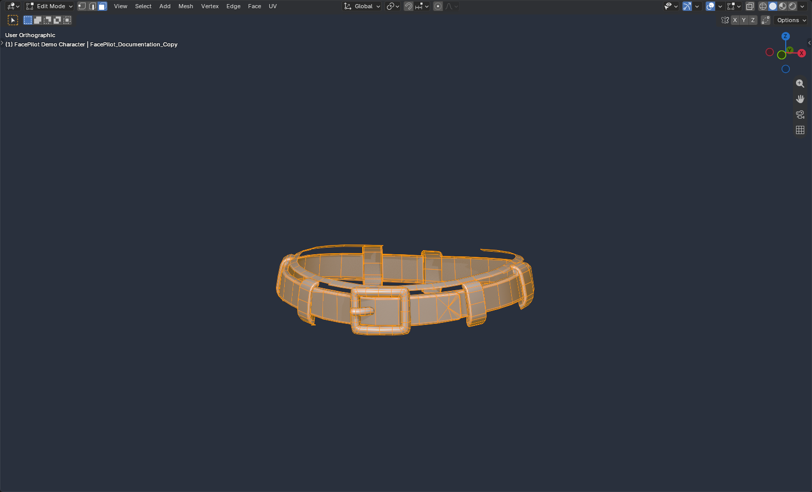

Isolation does not delete geometry. Its undo-aware visibility backup uses temporary integer mesh attributes, separate from the GPU color previews. Restore isolation before topology edits; after incompatible changes, the old visibility backup is not applied.

## 9. List possible missing faces and openings

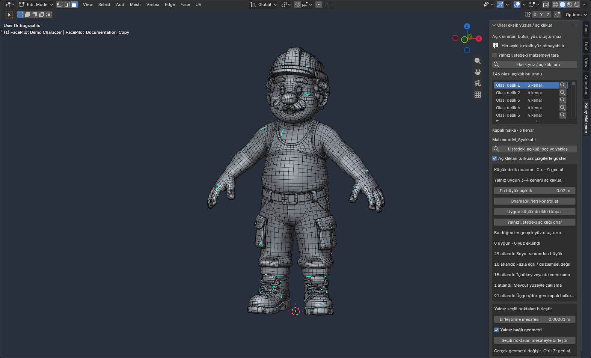

Expand **Açıklıklar ve onarım**, then:

1. Click **Eksik yüz / açıklık tara**.
2. Inspect the list: edge count, closed loop / chain / branch, and adjacent material names.
3. Use a row's magnifier or **Seç ve yaklaş** to select its boundary edges and focus the view.
4. Enable **Açıklıkları turkuaz çizgilerle göster** to show cyan outlines.
5. Optionally enable **Yalnız listedeki malzemeyi tara**, then scan again to filter by the active material.

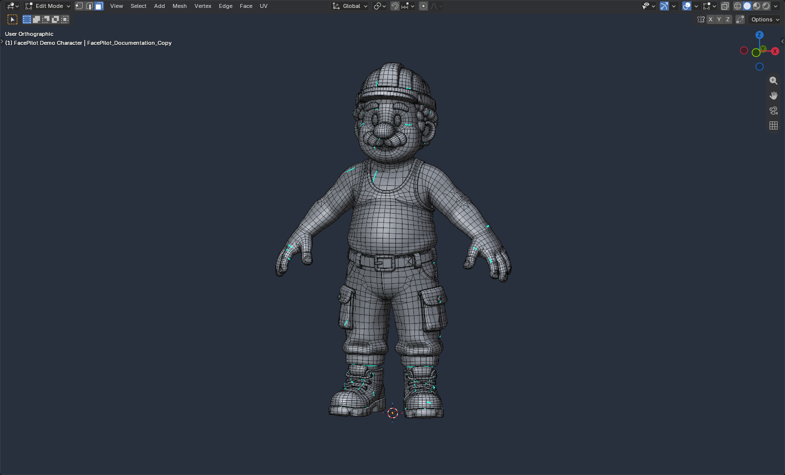

The scanner groups edges with **exactly one linked face**. A clothing opening or disconnected surface border may be intentional; an entry is a candidate opening, not proof of a defect. Hidden faces still count in topology, so hiding one does not create a fake hole. Wire-only geometry, fully missing parts and every possible non-manifold defect are outside this scan's scope. Re-scan after topology edits.

## 9.1. Ignore openings you want to keep · new in 1.8

Choose a list row and click **Yoksay**, or its **×** button. The opening disappears from the list and cyan overlay and is excluded from both strict repair and repair previews. Its geometry, UVs, material and current selection stay unchanged.

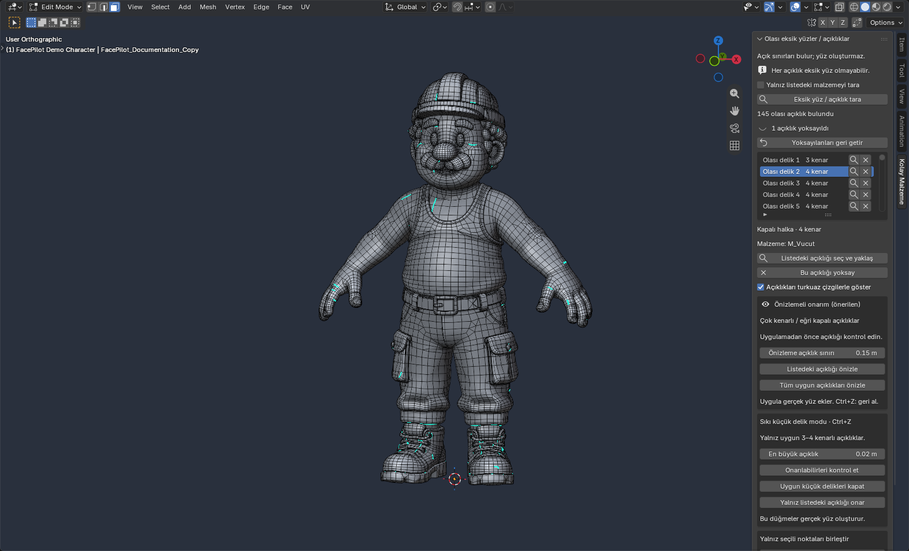

**Yoksayılanları geri getir** restores all ignored openings for the current mesh. Re-scanning or switching the material filter keeps your exclusions. Ignoring or restoring cancels any pending violet proposal: rebuild it before applying. Add-on repairs preserve exclusions for boundaries that remain unchanged; external topology changes or welding reset the index-based exclusions. These preferences are session-only and clear when reopening the file or disabling the add-on.

## 10. Preview a repair before applying it · new in 1.7

In the scan panel, use **Önizlemeli onarım**:

1. Scan the mesh, choose an opening in the list, and inspect it with the magnifier.
2. Set **Önizleme açıklık sınırı** (default **0.15 world units**, 15 cm at the default meter scale).
3. Click **Listedeki açıklığı önizle** for that row, or **Tüm uygun açıklıkları önizle** for the current scan.
4. Inspect the **translucent violet triangles**. Adjust **Yama saydamlığı** as needed. The panel reports proposed patches/triangles and skipped reasons; **no real faces have been added**.
5. Click **Uygula** to create exactly the shown triangles, or **İptal** to discard the overlay. **Ctrl+Z** undoes an applied repair.

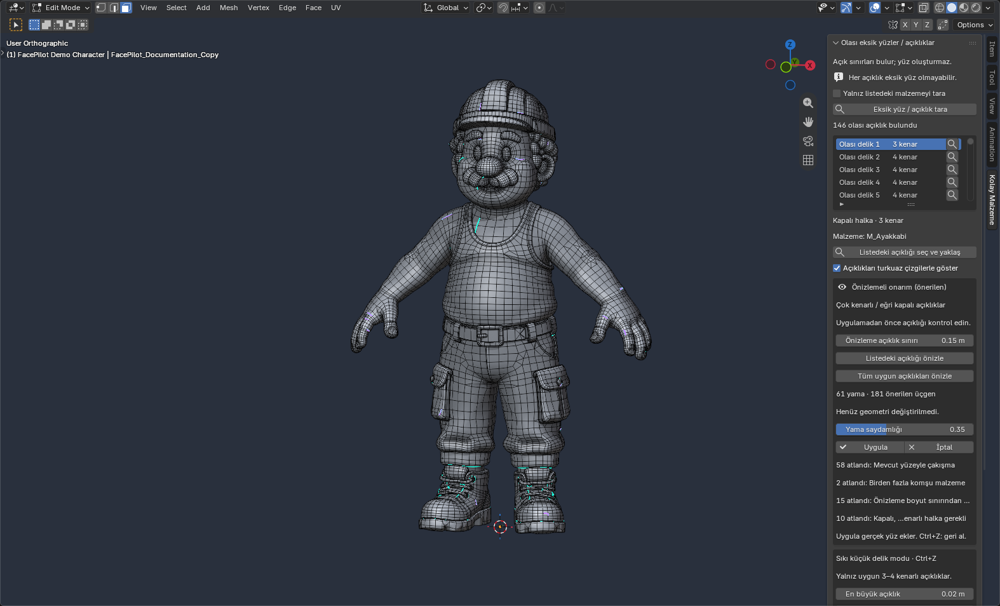

This mode supports **3–256-edge closed loops**, including concave and curved/nonplanar boundaries. Triangulation is calculated on a copy. Each patch needs one adjacent material and consistent boundary winding. Hidden geometry, invalid/degenerate boundaries, existing-surface collisions, collisions between proposals, and interior diagonals already used by other faces are rejected. This mode can still propose closing an intentional opening: inspect it before applying.

| Controlled eight-edge opening | Violet proposal | Applied on a disposable copy |
|---|---|---|
| 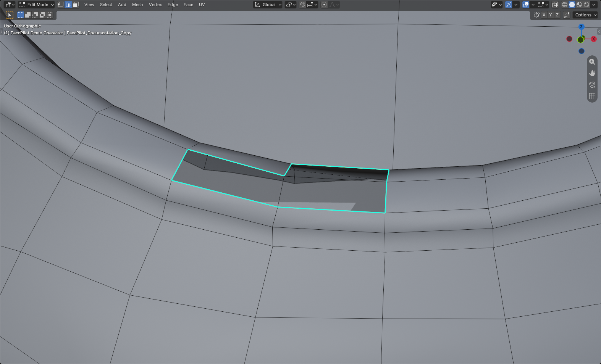 | 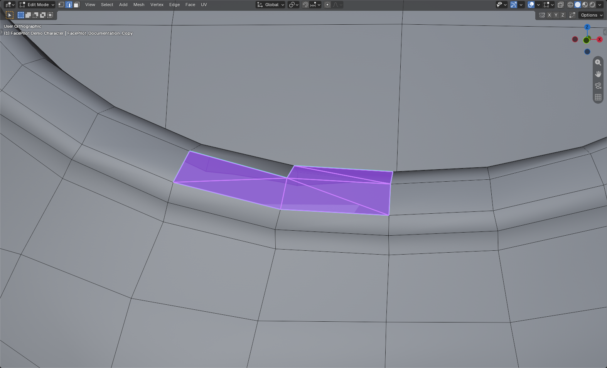 | 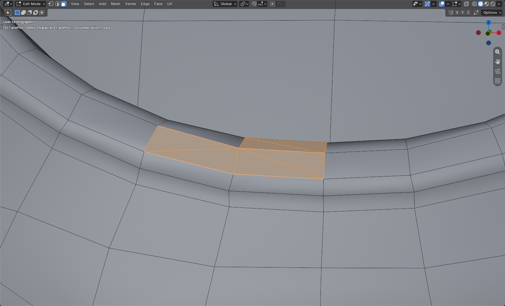 |

*For the close-up, three neighboring shirt quads were deliberately removed on the copy, creating an eight-edge opening. The preview kept its 27,696 real faces unchanged; Apply added six triangles, reaching 27,702 faces. This demonstration never edited the live original.*

The preview is runtime GPU data and is not exported. Selection and camera changes are allowed; changes to coordinates, topology, visibility, materials, UVs or object transform invalidate the proposal. Rebuild after changing the size limit. New triangles inherit the adjacent material and copied patch UV data; **check new UVs before texturing**. No smoothing, remeshing, welding, automatic unwrap or semantic hole classification is performed.

## 10.1. Strict small-hole mode

In **Gelişmiş onarım (Advanced repair)**, set **En büyük açıklık**, then **Onarılabilirleri kontrol et**. This check reports eligible/skipped regions without editing geometry. **Uygun küçük delikleri kapat** patches all eligible regions in the current scan; **Yalnız listedeki açıklığı onar** limits the operation to the active list row.

This separate **Sıkı küçük delik modu** retains the old conservative behavior. The default size is **0.02 world units** (2 cm with Blender's default meter scale). Only visible, convex, sufficiently planar **3- or 4-edge closed loops** qualify. Its numeric **Onarılabilirleri kontrol et** is a count check, separate from the violet geometric preview above. Mixed adjacent materials, inconsistent winding, nearby non-manifold junctions, excessive size, degenerate/warped boundaries and existing-surface overlaps are skipped with reasons.

| Before: controlled missing triangle | After: one face added |
|---|---|
| 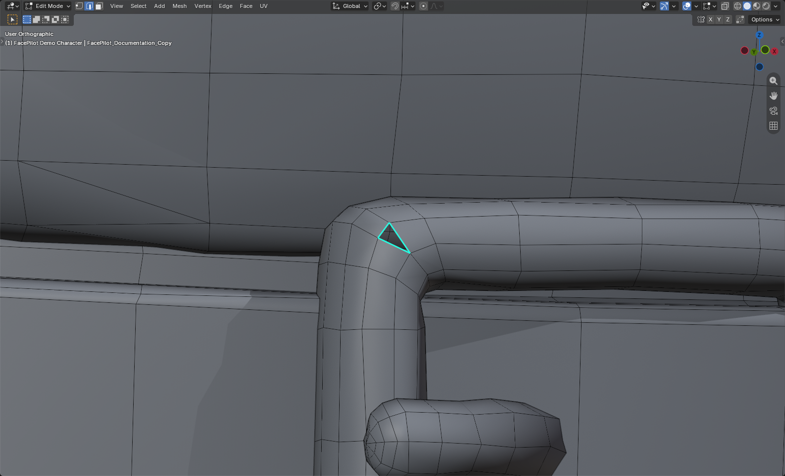 | 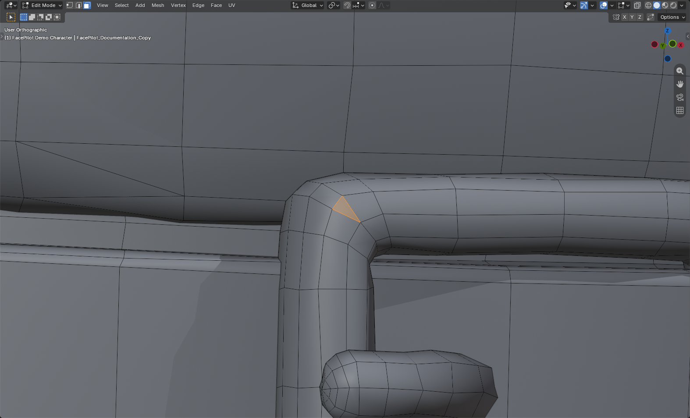 |

*For this demonstration, one triangle was deliberately removed from the copied belt buckle and repaired with a 0.04 size limit. The scan grew from 146 to 147 regions, then returned to 146 after adding one face. The original character was not repaired or modified.*

New patches inherit the adjacent material and align with neighboring face winding. Existing-face UVs are preserved; **check the new patch's UVs before texturing**. This does not automatically unwrap, retopologize or decide whether an intentional opening should be closed. **Ctrl+Z** undoes repair.

## 11. Merge close selected vertices

In **Gelişmiş onarım (Advanced repair) → Seçili noktaları birleştir**, select the intended vertices, set **Birleştirme mesafesi**, leave **Yalnız bağlı geometri** enabled for a conservative start, and click **Seçili noktaları mesafeyle birleştir**.

Only selected, visible vertices participate. The default threshold is **0.00001 world units**. The connected-only option restricts welding to connected geometry; turn it off deliberately when joining disconnected duplicate points. Under non-uniform scale the local threshold is reduced conservatively, so some close pairs may remain unmerged. **Ctrl+Z** undoes it.

Welding points and filling a missing face solve different problems. A weld does not guarantee a correct face, clean edge flow or good UVs. Inspect the area after each real geometry operation.

## Undo and view recovery

**After Remove material, Ctrl+Z restores the material slots and face assignments and returns to Object Mode.** The FacePilot editing controls then become unavailable. Select the mesh if needed and press **Tab** to return to Edit Mode. **Ctrl+Shift+Z** redoes the removal. A mode change alone is not evidence of deleted geometry; compare the material list and face counts in Edit Mode.

| What you want to reverse | Use |
|---|---|
| A material removal, real assignment, transfer, applied patch or weld | **Ctrl+Z**; after material-removal undo, **Tab** resumes editing. |
| Material-eye hiding | Its **Show** button/closed eye; **Ctrl+Z** can also undo that visibility edit. |
| FacePilot isolation | **Restore**, preserving faces hidden before isolation. **Reveal all hidden faces** reveals those too. |
| Individual/all preview colors | **Clear active color / Clear all colors** in Visual preview. |
| Black mask and preview colors together | **Reset visual previews** in Visual preview. Red marks and isolation stay separate. |
| All red correction marks | **Clear all red marks**; disable **Ctrl red marking** to stop the gesture. |
| A violet proposal that has not been applied | **Cancel** in Openings & repair; no geometry was added. |

Preview colors, marks, saved selections, ignored openings and pending proposals are session tools. Do not rely on Ctrl+Z or saving the `.blend` file to preserve/restore that runtime state. In particular, removal clears its red marks and pending proposal even if you subsequently undo the material edit.

## Troubleshooting

| Symptom | What to check |
|---|---|
| Buttons are unavailable | Select one mesh and enter Edit Mode; multi-object editing is unsupported. |
| The panel became unavailable after removal undo | Blender returned to Object Mode. Select the mesh and press **Tab**. |
| “Source and target match” while removing | Pick a different **Removal target**; slot 1 cannot transfer to itself. Duplicate slots for the source material also count as the same source. |
| A material has 0 visible faces | Check **visible / total** below the list. **0 / 1** is one hidden face; **0 / 0** is an unused slot. Use **Show** for hidden faces. |
| Removed material is still in Blender's picker | The global material datablock is retained; only this object's source slots were removed. |
| Eye button is unavailable | No faces are assigned to that material; an empty slot has nothing to show/hide. |
| Ctrl behaves differently | Turn off **Ctrl ile kırmızı işaretle** after marking. |
| Cannot mark a face red | It must initially be visible and orange-selected. |
| No eligible repair regions | Read skip reasons; many openings are large, irregular or intentional. Do not increase the size limit blindly. |
| The scan finds openings but strict mode says 0 eligible | Scan counts all candidate boundaries. Strict repair accepts only suitable 3–4-edge loops; inspect **Openings & repair → Preview repair** for larger/curved loops. |
| Selection memory / scan / marks disappear | Topology changed, the mesh changed, or the session was reset. Re-scan or reselect. |
| Color picker did not update the mesh | Click **Bu malzemeye renk ver** again after editing the picker. |
| Colors are obscured | Clear black previews, exit isolation if needed, and inspect the base mesh. |
| Overlay does not match a modifier surface | Overlays track the base edit mesh; geometry-changing modifiers can differ. |
| A face still has the old material after deselect | Deselecting changes selection only. Use an explicit assign/transfer action. |

## Quality & project files

The Blender 5.2.3 background suite currently reports **71 tests: 70 passed, 1 GUI-only test skipped**. It covers selection, material transfer/undo, preview export invariance, red-mark lifecycle, isolation/undo, boundary scanning, repair/material/normal/UV behavior and merge undo. See [development instructions](docs/DEVELOPMENT.md) for the exact command and the limits of this evidence.

```text
kolay_malzeme_tr.py         Add-on source; stable module name
dist/FacePilot-1.11.0.zip    Installable single-file add-on
README.md / README.tr.md   Complete English / Turkish guides
docs/images/              Actual Blender screenshots
docs/brand/               FacePilot logo artwork
tests/test_addon.py        Disposable Blender regression fixtures
```

All model screenshots were captured in a separate Blender session from a temporary copy of the user's character. The source character `.blend` and its textures are not distributed. The FacePilot banner is generated brand artwork; it is not a Blender screenshot. See [screenshot notes](docs/SCREENSHOTS.md) and [changelog](CHANGELOG.md).
