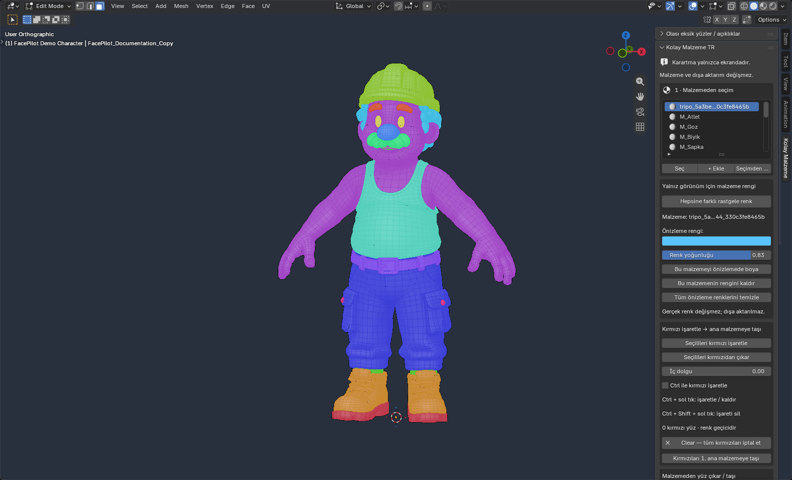

<p align="center">
  
</p>

<p align="center">
  <strong>Precise face selection. Clear material boundaries. Controlled mesh repairs.</strong><br>
  A Blender companion for cleaning up material assignments before texturing.
</p>

<p align="center">
  <a href="README.md"><strong>English</strong></a> ·
  <a href="README.tr.md"><strong>Türkçe</strong></a> ·
  <a href="dist/FacePilot-1.6.0.zip">Download v1.6.0</a> ·
  <a href="docs/SHORTCUTS.md">Shortcut reference</a> ·
  <a href="docs/DEVELOPMENT.md">Development & tests</a>
</p>

<p align="center"><code>Blender 5.2.3 LTS tested</code> &nbsp; <code>Turkish UI</code> &nbsp; <code>No extra packages</code> &nbsp; <code>GPU-only previews</code></p>


*One click, sixteen materials, sixteen temporary colors. The actual shaders stay intact.*

## Why FacePilot?

You select the belt, discover a few trouser faces belong to it, and need to fix those faces without losing your place. FacePilot puts material selection, temporary visual separation, correction marks and explicit reassignment in one sidebar. It also lists open mesh boundaries and can patch suitable small holes.

The project name is **FacePilot**. The installed add-on retains the name **Kolay Malzeme TR**, the module `kolay_malzeme_tr.py`, and its Turkish controls. English instructions below quote the exact buttons you will see.

| Workflow | What you get | Changes to the model |
|---|---|---|
| Select & refine | Material selection, smart regions, brush add/subtract, grow/shrink, selection memory | Selection only |
| See clearly | Random material colors, individual colors, four black preview modes | Viewport only |
| Mark & correct | Transparent red correction outlines, toggle/erase/clear | Marking is temporary; **Transfer** changes material assignments |
| Reassign | Move faces to slot 1 or another chosen material; assign/create a material | Real material assignments |
| Inspect | Open-boundary list, cyan overlay, focus on a listed region | Scan is read-only; focus changes selection/view |
| Repair | Conservative small-hole filling and selected-vertex welding | Real geometry; **Ctrl+Z** to undo |

## Install in a minute

1. Download [FacePilot-1.6.0.zip](dist/FacePilot-1.6.0.zip). Use the add-on ZIP, rather than GitHub's whole-repository ZIP.
2. In Blender, open **Edit → Preferences → Add-ons → menu → Install from Disk**.
3. Choose the ZIP and enable **Kolay Malzeme TR**. Installing [kolay_malzeme_tr.py](kolay_malzeme_tr.py) directly also works.
4. Select **one mesh**, press **Tab** for Edit Mode, then **N → Kolay Malzeme** in the 3D Viewport.

Tested with **Blender 5.2.3 LTS**. The add-on declares Blender 4.2 as its minimum; earlier supported versions have not been validated by this repository's test run. No external Python libraries or service connection are needed.



## 1. Select an entire material

Choose a material in **1 · Malzemeden seçim**, for example `M_Kemer` (belt), then use:

| Button | Result |
|---|---|
| **Seç** | Replace your selection with the visible faces assigned to this material. |
| **+ Ekle** | Add those faces to your current selection. |
| **Seçimden çıkar** | Remove those faces from the selection. Their material stays assigned. |


**Deselecting a face and removing it from a material are different actions.** To change its actual assignment, use the transfer tools in section 5.

## 2. Pick a region with Smart Selection

In **Akıllı bölge seçimi**, choose a method, press **Akıllı seçim: bölgeye tıkla**, then click the mesh.

| Method | How it chooses faces |
|---|---|
| **Otomatik** | Uses an assigned non-first material as a group; on the first material or unassigned faces, uses connected surface boundaries. |
| **Aynı malzeme** | Selects all visible faces sharing the clicked face's material, including disconnected pieces. |
| **Yüzey sınırları** | Follows connected faces within the angle threshold, stopping at material boundaries, seams, sharp edges and hidden faces. |

**Shift-click** adds a region; **Ctrl-click** subtracts it. **Esc** or right-click cancels the picking step. Lower **Açı sınırı** for tighter surface regions; raise it for broader regions.

This is geometry/material-based selection. It does not semantically recognize a belt in an unlabeled mesh, and it cannot correct an incorrect material boundary by itself. The belt screenshot above demonstrates selection of an existing material group.

## 3. Refine and remember a selection

Under **2 · Seçimi düzelt**:

| Control | Use |
|---|---|
| **Fırça + / Fırça −** | Activate Blender's circle selection tool in add/subtract mode. Adjust **Fırça boyutu**. |
| **Kutu seçimine dön** | Return to the standard box selection tool. |
| **Büyüt / Küçült** | Grow or shrink the current face selection by one step. |
| **Ters çevir / Temizle** | Invert or clear the visible face selection. |
| **Seçimi sakla / Geri çağır** | Store and restore one selection for the current mesh in this session. |

You can also use Blender's normal **B** box, **C** circle and lasso tools. Turn **Alt+Z / X-Ray off** when you want to avoid selecting through the mesh. Selection memory is rejected after topology changes, preventing old face indices from selecting unrelated faces.

## 4. Mark corrections in transparent red

Select the belt first. In **Kırmızı işaretle → ana malzemeye taşı**, choose either workflow:

**With normal selection tools:** select the unwanted faces, click **Seçilileri kırmızı işaretle**, and repeat as needed. Select mistakes and click **Seçilileri kırmızıdan çıkar** to unmark them.

**With Ctrl painting:** enable **Ctrl ile kırmızı işaretle**, then **Ctrl + left-click/drag** across selected faces. Clicking a marked face toggles its mark off. A drag follows the first face: start on red to erase, or on unmarked to add. **Ctrl+Shift + left-click/drag** always erases; **Esc** cancels the current stroke.


*The ordinary orange selection was cleared for this image to make the persistent red outlines easier to see. Marking initially requires selected, visible faces.*

The fill defaults to **0**, keeping the inside transparent; **İç dolgu** optionally adds tint. Marks accumulate independently of subsequent normal selections. **Clear — tüm kırmızıları iptal et** cancels all marks without changing assignments.

When ready, **Kırmızıları 1. ana malzemeye taşı** moves marked faces to the **first material slot (internal index 0)** and removes them from the orange selection. This is a real assignment change. The first slot is not necessarily named `M_Vucut`; check your own material order. Use **Ctrl+Z** to undo the transfer.


*This transfer was demonstrated only on a disposable copy. Random preview colors make the resulting groups visible.*

Disable the Ctrl checkbox to restore Blender's ordinary Ctrl behavior. Smart Selection's Ctrl-click subtracts a region during its own picking step. Marks reset on topology changes; clear/re-mark if you independently reassign their materials.

## 5. Move faces to a chosen material

In **Malzemeden yüz çıkar / taşı**:

1. Select the **source** material in the list, such as `M_Kemer`.
2. Select the faces that should leave it.
3. Set **Hedef** to **Ana malzeme (1. yuva)** or another existing slot, such as `M_Pant`.
4. Click **Seçili yüzleri malzemeden çıkar**.

Only selected, visible faces currently belonging to the source material are transferred. The source material is kept. Matching source/target slots are rejected. This workflow handles any chosen destination; the red transfer button specifically targets the first slot.

For general assignment, use **5 · Gerçek malzeme ataması → Seçime listedeki malzemeyi ata**. To create one, type its name and choose **Oluştur ve seçime ata**; an existing material with that name is reused. These operations change real assignments and support **Ctrl+Z**.

## 6. Give every material a different preview color

Under **Yalnız görünüm için malzeme rengi**, press **Hepsine farklı rastgele renk**. Every unique material on the active mesh gets a distinct color; repeated slots referencing the same material share its color. No face-by-face selection is needed. Press again to generate another palette.

To color only one material, select it, set **Önizleme rengi** and **Renk yoğunluğu**, then click **Bu malzemeyi önizlemede boya**. Apply again after changing the picker. Different materials retain independent preview colors.


**Bu malzemenin rengini kaldır** clears one material; **Tüm önizleme renklerini temizle** clears all. **Normal görünüme dön** clears the color previews and black mask. Randomize-all turns the black mask off so the palette can be seen.

## 7. Darken distractions without painting the material

Under **3 · Geçici siyah önizleme**, choose:

| Mode | What becomes dark |
|---|---|
| **Seçileni karart** | Selected faces |
| **Diğer yüzleri karart** | Faces outside the current selection |
| **Bu malzemeyi karart** | Faces using the active material |
| **Diğer malzemeleri karart** | Faces using all other materials |

Adjust **Karartma** for opacity. **Normal görünüme dön** restores the normal view.


**Preview colors, black masks and red marks are GPU viewport overlays.** They do not change Base Color, shader nodes, texture images, UVs, vertex colors, face material assignments, or export data. They do not appear in renders, bakes, FBX/OBJ/glTF or Substance Painter imports. They are cleared when the file is reopened or the add-on is disabled. Real assignment and repair buttons, however, do change the model.

## 8. Isolate fine details

Under **4 · İnce çalışma için gizle**, **Diğerlerini gizle** hides faces outside the selection. **Geri al** restores the previous hidden state, preserving faces that were already hidden. **Tüm gizlileri göster** reveals all faces, including ones hidden before isolation.


Isolation does not delete geometry. Its undo-aware visibility backup uses temporary integer mesh attributes, separate from the GPU color previews. Restore isolation before topology edits; after incompatible changes, the old visibility backup is not applied.

## 9. List possible missing faces and openings


Expand **Olası eksik yüzler / açıklıklar**, then:

1. Click **Eksik yüz / açıklık tara**.
2. Inspect the list: edge count, closed loop / chain / branch, and adjacent material names.
3. Use a row's magnifier or **Listedeki açıklığı seç ve yaklaş** to select its boundary edges and focus the view.
4. Enable **Açıklıkları turkuaz çizgilerle göster** to show cyan outlines.
5. Optionally enable **Yalnız listedeki malzemeyi tara**, then scan again to filter by the active material.


The scanner groups edges with **exactly one linked face**. A clothing opening or disconnected surface border may be intentional; an entry is a candidate opening, not proof of a defect. Hidden faces still count in topology, so hiding one does not create a fake hole. Wire-only geometry, fully missing parts and every possible non-manifold defect are outside this scan's scope. Re-scan after topology edits.

## 10. Patch suitable small holes

In the scan panel, set **En büyük açıklık**, then **Onarılabilirleri kontrol et**. This check reports eligible/skipped regions without editing geometry. **Uygun küçük delikleri kapat** patches all eligible regions in the current scan; **Yalnız listedeki açıklığı onar** limits the operation to the active list row.

The default size is **0.02 world units** (2 cm with Blender's default meter scale). Only visible, convex, sufficiently planar **3- or 4-edge closed loops** qualify. Mixed adjacent materials, inconsistent winding, nearby non-manifold junctions, excessive size, degenerate/warped boundaries and existing-surface overlaps are skipped with reasons.

| Before: controlled missing triangle | After: one face added |
|---|---|
|  |  |

*For this demonstration, one triangle was deliberately removed from the copied belt buckle and repaired with a 0.04 size limit. The scan grew from 146 to 147 regions, then returned to 146 after adding one face. The original character was not repaired or modified.*

New patches inherit the adjacent material and align with neighboring face winding. Existing-face UVs are preserved; **check the new patch's UVs before texturing**. This does not automatically unwrap, retopologize or decide whether an intentional opening should be closed. **Ctrl+Z** undoes repair.

## 11. Merge close selected vertices

In **Yalnız seçili noktaları birleştir**, select the intended vertices, set **Birleştirme mesafesi**, leave **Yalnız bağlı geometri** enabled for a conservative start, and click **Seçili noktaları mesafeyle birleştir**.

Only selected, visible vertices participate. The default threshold is **0.00001 world units**. The connected-only option restricts welding to connected geometry; turn it off deliberately when joining disconnected duplicate points. Under non-uniform scale the local threshold is reduced conservatively, so some close pairs may remain unmerged. **Ctrl+Z** undoes it.

Welding points and filling a missing face solve different problems. A weld does not guarantee a correct face, clean edge flow or good UVs. Inspect the area after each real geometry operation.

## Troubleshooting

| Symptom | What to check |
|---|---|
| Buttons are unavailable | Select one mesh and enter Edit Mode; multi-object editing is unsupported. |
| Ctrl behaves differently | Turn off **Ctrl ile kırmızı işaretle** after marking. |
| Cannot mark a face red | It must initially be visible and orange-selected. |
| No eligible repair regions | Read skip reasons; many openings are large, irregular or intentional. Do not increase the size limit blindly. |
| Selection memory / scan / marks disappear | Topology changed, the mesh changed, or the session was reset. Re-scan or reselect. |
| Color picker did not update the mesh | Click **Bu malzemeyi önizlemede boya** again after editing the picker. |
| Colors are obscured | Clear black previews, exit isolation if needed, and inspect the base mesh. |
| Overlay does not match a modifier surface | Overlays track the base edit mesh; geometry-changing modifiers can differ. |
| A face still has the old material after deselect | Deselecting changes selection only. Use an explicit assign/transfer action. |

## Quality & project files

The Blender 5.2.3 background suite currently reports **45 tests: 44 passed, 1 GUI-only test skipped**. It covers selection, material transfer/undo, preview export invariance, red-mark lifecycle, isolation/undo, boundary scanning, repair/material/normal/UV behavior and merge undo. See [development instructions](docs/DEVELOPMENT.md) for the exact command and the limits of this evidence.

```text
kolay_malzeme_tr.py         Add-on source; stable module name
dist/FacePilot-1.6.0.zip    Installable single-file add-on
README.md / README.tr.md   Complete English / Turkish guides
docs/images/              Actual Blender screenshots
docs/brand/               FacePilot logo artwork
tests/test_addon.py        Disposable Blender regression fixtures
```

All model screenshots were captured in a separate Blender session from a temporary copy of the user's character. The source character `.blend` and its textures are not distributed. The FacePilot banner is generated brand artwork; it is not a Blender screenshot. See [screenshot notes](docs/SCREENSHOTS.md) and [changelog](CHANGELOG.md).
