<p align="center">
  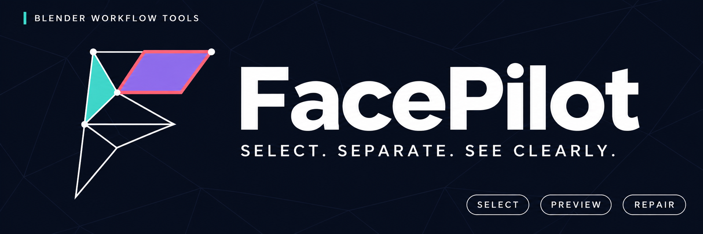
</p>

<p align="center">
  <strong>Hassas yüz seçimi. Net malzeme sınırları. Kontrollü mesh onarımı.</strong><br>
  Boyamaya geçmeden önce malzeme atamalarını düzenlemek için Blender yardımcın.
</p>

<p align="center">
  <a href="README.tr.md"><strong>Türkçe</strong></a> ·
  <a href="README.md"><strong>English</strong></a> ·
  <a href="dist/FacePilot-1.11.0.zip">v1.11.0 indir</a> ·
  <a href="docs/SHORTCUTS.md">Kısayollar</a> ·
  <a href="docs/DEVELOPMENT.md">Geliştirme ve testler</a>
</p>

<p align="center"><code>Blender 5.2.3 LTS üzerinde test edildi</code> &nbsp; <code>TR/EN arayüz</code> &nbsp; <code>Ek paket gerektirmez</code></p>

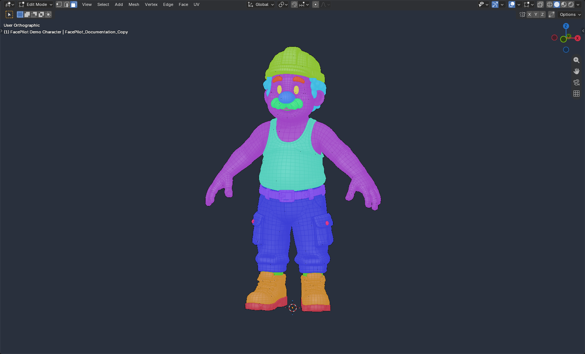

*Tek tık, 16 malzeme, 16 geçici renk. Gerçek shader'lar aynı kalır.*

## FacePilot ne işe yarar?

Kemeri seçtin ama birkaç pantolon yüzü de yanlışlıkla kemere atanmış. Bu yüzleri düzeltirken seçimini kaybetmeden, hangi parçanın hangi malzemeye ait olduğunu net görmek istiyorsun. FacePilot; malzemeden seçim, geçici renkler, kırmızı düzeltme işaretleri ve gerçek atama araçlarını aynı panelde toplar. Açık mesh sınırlarını listeler ve uygun küçük delikleri kapatabilir.

Projenin İngilizce adı **FacePilot**. Blender'daki eklenti adı **Kolay Malzeme TR** ve modül adı `kolay_malzeme_tr.py` korunur. v1.9'dan itibaren panelin üstünde bağımsız **Türkçe / English** dil seçimi bulunur.

| İş akışı | Araçlar | Modele etkisi |
|---|---|---|
| Seç ve düzelt | Malzemeden seçim, akıllı bölge, fırça +/−, büyüt/küçült, seçim hafızası | Yalnız seçim |
| Net gör | Her malzemeye rastgele renk, tek malzeme rengi, dört siyah önizleme | Yalnız ekran |
| Kırmızı işaretle | Saydam kırmızı çerçeveler, aç/kapat, sil, Clear | İşaretler geçici; **taşıma** gerçek atamadır |
| Yeniden ata | İlk yuvaya veya seçilen hedefe taşı; mevcut/yeni malzeme ata | Gerçek malzeme ataması |
| İncele | Açık sınır listesi, turkuaz çizgiler, bölgeye yaklaş | Tarama değişiklik yapmaz; odaklama seçimi/görünümü değiştirir |
| Onar | Uygun küçük deliği kapat, seçili noktaları birleştir | Gerçek geometri; **Ctrl+Z** ile geri alınır |

## Bir dakikada kurulum

1. [FacePilot-1.11.0.zip](dist/FacePilot-1.11.0.zip) dosyasını indir. GitHub'ın bütün repo ZIP'i yerine bu eklenti ZIP'ini kullan.
2. Blender'da **Edit → Preferences → Add-ons → menü → Install from Disk** yolunu aç.
3. ZIP'i seç ve **Kolay Malzeme TR** eklentisini etkinleştir. [kolay_malzeme_tr.py](kolay_malzeme_tr.py) dosyasını doğrudan kurmak da mümkün.
4. **Tek bir mesh** seç, **Tab** ile Düzenleme Modu'na geç, 3B Görünüm'de **N → FacePilot** sekmesini aç.

**Blender 5.2.3 LTS** üzerinde test edildi. Eklentinin bildirdiği minimum sürüm 4.2'dir; daha eski desteklenen sürümler bu repodaki test çalışmasıyla doğrulanmadı. Harici Python paketi veya servis bağlantısı gerekmez.

## Düzen ve dil seçimi · 1.9 yeniliği

**N → FacePilot** sekmesinin en üstünden **Türkçe / English** seç. Panel, menüler, işlem araç ipuçları, raporlar ve etkileşimli yönergeler seçilen dili kullanır. Blender'ın genel dili ve malzeme/obje adları değişmez. Tercih eklentinin Blender ayarlarında saklanır; otomatik ayar kaydı kapalıysa Save Preferences kullan.

Üstte seçili/gizli yüz sayısı, etkin malzeme ve **Yalıt / Geri göster** kısayolları bulunur. Bölümler ayrı açılıp kapanır; dil değiştirince aynı bölüm durumu korunur. Geçici görünüm araçları ile gerçek atama/geometri işlemleri ayrı belirtilir.

- **Seçim:** Malzeme listesi, fırça, büyüt/küçült ve seçim hafızası.
- **Akıllı seçim:** Bölge seçimi, yöntem ve açı sınırı.
- **Görsel önizleme:** Geçici renkler ve siyah karartma.
- **Kırmızı düzeltme:** İşaretleme, temizleme ve ilk yuvaya taşıma.
- **Malzeme atama:** Hedefe taşıma, atama ve yeni malzeme.
- **Açıklıklar ve onarım:** Tarama, yoksayma ve mor yama önizlemesi.
- **Gelişmiş onarım:** Sıkı küçük delik modu ve seçili nokta birleştirme.

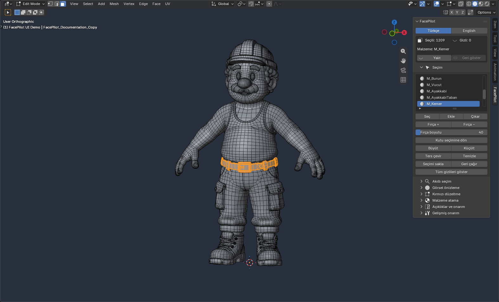

## 1. Bir malzemenin tüm yüzlerini seç

**Seçim** listesinden örneğin `M_Kemer` seç:

| Düğme | Ne yapar? |
|---|---|
| **Seç** | Mevcut seçimin yerine bu malzemeye atanmış görünür yüzleri seçer. |
| **Ekle** | Bu yüzleri mevcut seçimine ekler. |
| **Çıkar** | Bu yüzleri turuncu seçimden çıkarır; malzeme ataması korunur. |

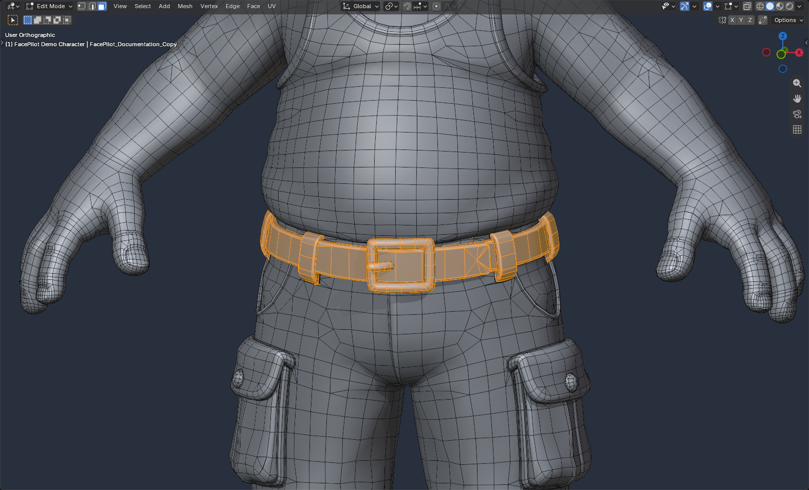

**Yüzü seçimden çıkarmak ile malzemeden çıkarmak farklıdır.** Gerçek atamayı değiştirmek için 5. bölümdeki taşıma araçlarını kullan.

## 1.1. Malzemeyi Göster / Gizle · 1.10 yeniliği

Her malzeme satırında **göz simgesi** ve görünür yüz sayısı bulunur. Etkin malzemenin **görünür / toplam** sayısı listenin altında gösterilir. Açık göze basınca o malzemenin yüzleri gizlenir; kapalı göze basınca gösterilir. Bazı yüzleri görünür, bazıları gizliyse ilk tıklama hepsini gizler. Listenin altındaki **Göster / Gizle** düğmeleri etkin malzemeye uygulanır.

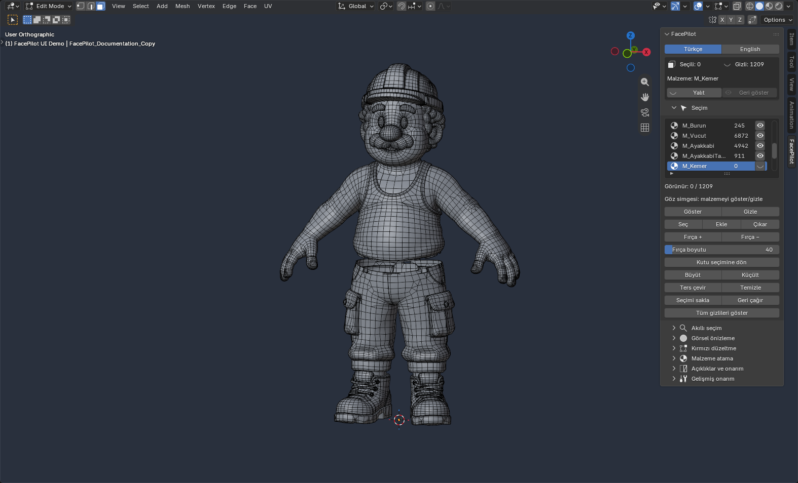

Diğer malzemelerin görünürlüğü korunur. Gösterilen yüzler otomatik seçilmez; gizlenen yüzlerin seçimi Blender'ın normal davranışıyla kalkar. Aynı malzemeye bağlı yinelenen yuvalar birlikte kontrol edilir. Geometri, UV ve gerçek atama değişmez; yalnız düzenleme görünürlüğü değişir. **Ctrl+Z** geri alır. Mevcut izolasyonun **Geri göster** düğmesi hâlâ çalışır; gözle sonradan yaptığın değişiklikler dahil izolasyon öncesi görünürlüğü geri getirir. Görünürlük değişince bekleyen yama önizlemesi temizlenir; onarımdan önce yeniden önizle.

## 1.2. Malzemeyi kaldır · 1.11 yeniliği

**Seçim** bölümünde kaldırılacak malzemeyi seç, **Silme hedefi** belirle (varsayılan: 1. ana yuva), ardından **Malzemeyi kaldır** düğmesine bas. Tek bir yüz kalmış olsa bile gizli ve seçilmemiş yüzler dahil tamamı hedefe taşınır. Malzemenin bu nesnedeki yuvaları kalkar; geometri, UV, görünürlük ve seçim korunur. Aynı malzemenin yinelenen yuvaları birlikte kaldırılır. Diğer nesnelerdeki kullanımlar ve asıl malzeme verisi korunur.

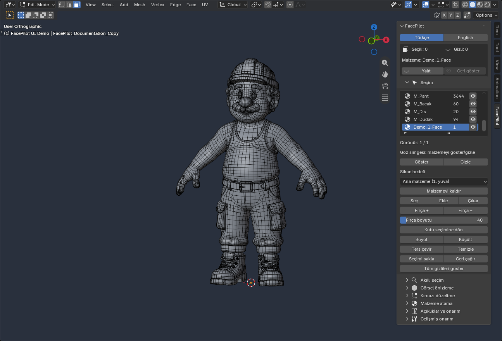

İlk yuvayı kaldırırken farklı bir hedef seç. Boş malzemeyi hedefsiz kaldırabilirsin; yüz atanmış son malzeme için önce başka malzeme gerekir. Mesh verisini başka nesneler paylaşıyorsa önce tek kullanıcılı yapmalısın. Başarılı kaldırma bekleyen onarım önizlemesini ve kırmızı işaretleri temizler. **Ctrl+Z** yuvaları ve atamaları birlikte geri getirir; geri alma/yineleme Blender'ı Nesne Modu'na döndürür. **Tab** ile düzenlemeye devam et. Malzeme yuvaları mesh düzenleme geri alma kaydına girmediğinden bu işlem tam Nesne Modu kayıtlarını kullanır.

## 2. Akıllı seçimle bölgeye tıkla

**Akıllı seçim** bölümünde yöntemi belirle, **Bölgeye tıkla** düğmesine bas ve mesh'e tıkla.

| Yöntem | Nasıl çalışır? |
|---|---|
| **Otomatik** | İlk yuva dışındaki atanmış malzemeyi grup olarak seçer. İlk malzemede veya atanmamış yüzlerde bağlı yüzey sınırlarına geçer. |
| **Aynı malzeme** | Tıklanan yüzün malzemesine ait tüm görünür yüzleri, ayrı duran parçalar dahil seçer. |
| **Yüzey sınırları** | Bağlı yüzeyde açı eşiğine kadar ilerler; malzeme sınırı, dikiş, keskin kenar ve gizli yüzde durur. |

**Shift + tık** bölge ekler, **Ctrl + tık** bölge çıkarır. **Esc** veya sağ tık seçim adımını iptal eder. **Açı sınırı** küçüldükçe keskin dönüşlerde daha erken durur, büyüdükçe daha geniş yüzeyi kapsar.

Bu yöntem geometri ve malzeme verisini kullanır. Etiketsiz bir mesh'te anlamsal olarak “bu bir kemer” demez; hatalı atanmış malzeme sınırını tek başına düzeltemez. Yukarıdaki kemer görseli mevcut bir malzeme grubunun seçimini gösterir.

## 3. Seçimi ince ayarla ve sakla

**Seçim** bölümünde:

| Araç | Kullanımı |
|---|---|
| **Fırça + / Fırça −** | Blender'ın daire seçim aracını ekleme/çıkarma modunda açar. **Fırça boyutu** ile alanı ayarla. |
| **Kutu seçimine dön** | Normal kutu seçim aracına döner. |
| **Büyüt / Küçült** | Seçimi bir adım genişletir/daraltır. |
| **Ters çevir / Temizle** | Görünür yüzlerde seçimi tersine çevirir veya kaldırır. |
| **Seçimi sakla / Geri çağır** | Bu mesh için oturum boyunca bir seçim yedeği tutar ve geri getirir. |

Blender'ın normal **B** kutu, **C** daire ve kement araçlarını da kullanabilirsin. Arkadaki yüzleri seçmek istemiyorsan **Alt+Z / X-Ray kapalı** olsun. Topoloji değişirse eski yüz numaraları yanlış yerleri seçmesin diye seçim hafızası uygulanmaz.

## 4. Çıkarmak istediklerini saydam kırmızı işaretle

Önce kemeri seç. **Kırmızı düzeltme** bölümünde iki yöntem var:

**Normal seçim araçlarıyla:** İstemediğin yüzleri seç, **Seçilileri kırmızı işaretle** düğmesine bas ve gerektiği kadar tekrarla. Yanlış işaretleri seçip **Seçilileri kırmızıdan çıkar** ile temizle.

**Ctrl ile boyayarak:** **Ctrl ile kırmızı işaretle** kutusunu aç. **Ctrl + sol tık/sürükleme** seçili yüzleri işaretler. Kırmızı yüze tekrar tıklamak işareti kaldırır. Sürüklemede ilk yüz davranışı belirler: kırmızıdan başlarsan siler, işaretsizden başlarsan ekler. **Ctrl+Shift + sol tık/sürükleme** her zaman siler; **Esc** o anki çizgiyi iptal eder.

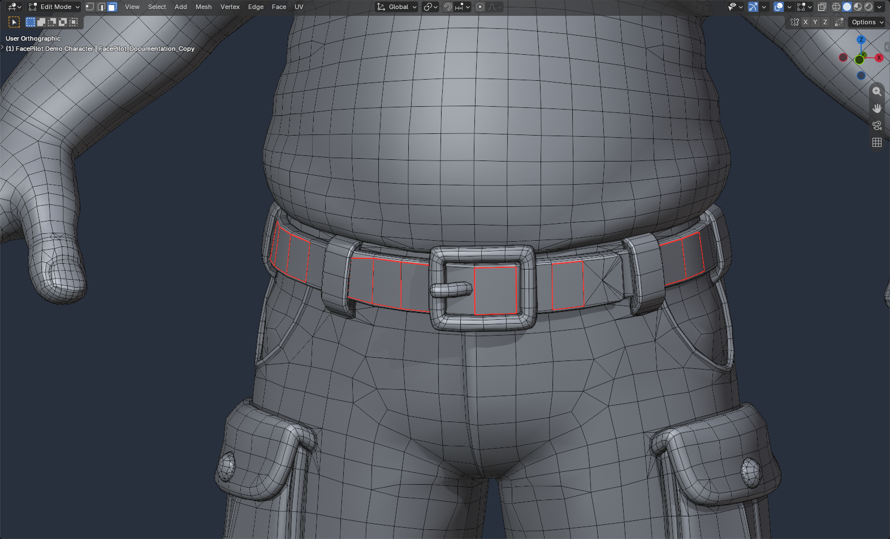

*Kırmızı çerçevelerin bağımsız kaldığını göstermek için bu görselde turuncu seçim sonradan temizlendi. İlk işaretleme sırasında yüzün görünür ve turuncu seçili olması gerekir.*

**İç dolgu** varsayılan **0**; yüzün içi saydam kalır. İstersen sürgüyle hafif renk ekleyebilirsin. Normal seçimi değiştirmek birikmiş işaretleri silmez. **Clear — tüm kırmızıları iptal et** bütün işaretleri kaldırır; gerçek atama değişmez.

Hazır olunca **İşaretlileri 1. yuvaya taşı** düğmesine bas. Kırmızı yüzler **ilk malzeme yuvasına (iç indeks 0)** taşınır ve turuncu seçimden çıkarılır. Bu gerçek atamadır. İlk yuva mutlaka `M_Vucut` değildir; kendi listendeki sırayı kontrol et. **Ctrl+Z** taşıma işlemini geri alır.

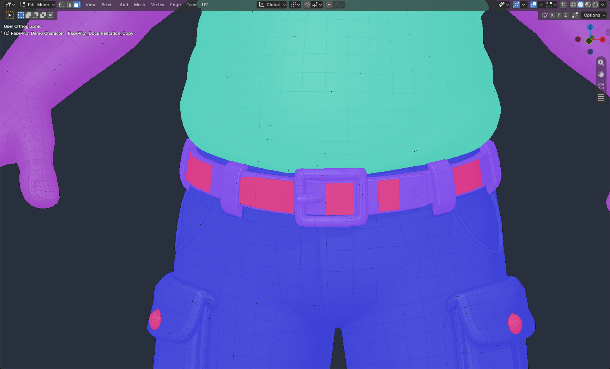

*Bu taşıma yalnız geçici model kopyasında gösterildi. Sonucu ayırt etmek için rastgele önizleme renkleri açıldı.*

Blender'ın normal Ctrl davranışına dönmek için kutucuğu kapat. Akıllı seçimin kendi tıklama adımında Ctrl, bölgeyi seçimden çıkarır. Topoloji değişince işaretler temizlenir; işaretli yüzlerin malzemesini başka yoldan değiştirdiysen temizleyip yeniden işaretle.

## 5. Yüzleri seçtiğin malzemeye taşı veya yeni malzeme ata

**Malzeme atama** bölümünde:

1. Listeden **kaynak** malzemeyi seç; örneğin `M_Kemer`.
2. Bu malzemeden çıkmasını istediğin yüzleri seç.
3. **Hedef** alanında **Ana malzeme (1. yuva)** veya `M_Pant` gibi başka bir mevcut malzeme seç.
4. **Seçili yüzleri malzemeden çıkar** düğmesine bas.

Yalnız görünür, seçili ve o an kaynak malzemeye ait yüzler taşınır. Kaynak malzeme silinmez. Kaynak ve hedef aynıysa işlem yapılmaz. Bu yöntem istediğin hedefe taşır; kırmızı taşıma düğmesi özellikle ilk yuvaya taşır.

Genel atama için **Malzeme atama → Seçime listedeki malzemeyi ata** kullanılır. Yeni malzeme için adını yazıp **Oluştur ve seçime ata** düğmesine bas; aynı adlı mevcut malzeme varsa yeniden kullanılır. Bunlar gerçek atamadır ve **Ctrl+Z** ile geri alınır.

## 6. Bütün malzemelere tek tıkla farklı renk ver

**Görsel önizleme → Rastgele renkler** düğmesine bas. Etkin mesh'teki her farklı malzemeye ayrı önizleme rengi verir. Aynı malzemeyi gösteren yinelenmiş yuvalar aynı rengi alır. Yüzleri tek tek seçmek gerekmez; tekrar basarsan yeni bir palet oluşturur.

Tek malzemeyi boyamak için listeden seç, **Önizleme rengi** ve **Renk yoğunluğu** ayarla, **Bu malzemeye renk ver** düğmesine bas. Renk seçiciyi değiştirdikten sonra tekrar uygula. Başka malzemelere verdiğin renkler kalır.

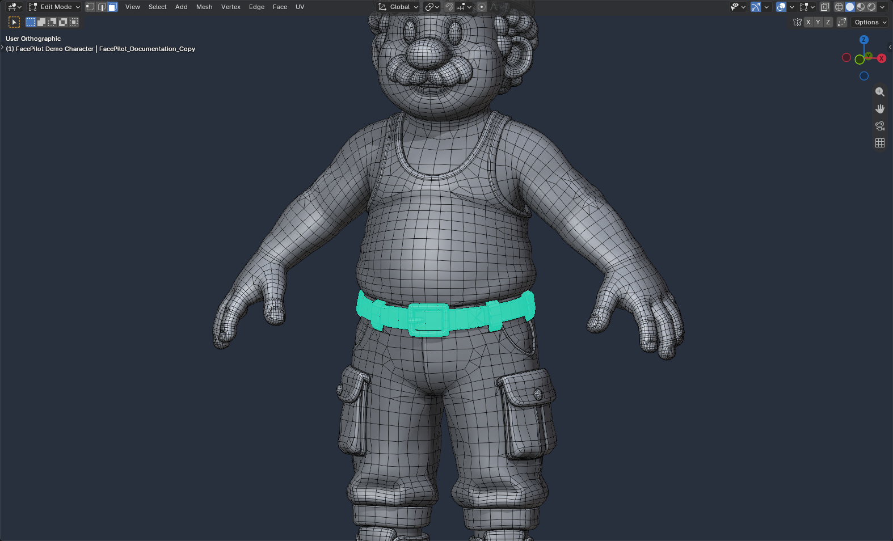

**Rengi kaldır** tek malzemeyi; **Renkleri temizle** tüm renkleri temizler. **Normal görünüme dön** renkleri ve siyah önizlemeyi kapatır. Rastgele renklendirme, palet görünür olsun diye siyah karartmayı kapatır.

## 7. Gerçek boya sürmeden diğer yüzleri karart

**Görsel önizleme → Karartma modu** bölümündeki seçenekler:

| Seçenek | Nereyi karartır? |
|---|---|
| **Seçileni karart** | Seçili yüzleri |
| **Diğer yüzleri karart** | Seçimin dışında kalan yüzleri |
| **Bu malzemeyi karart** | Etkin malzemeye ait yüzleri |
| **Diğer malzemeleri karart** | Etkin malzeme dışındaki malzemeleri |

**Karartma** ile opaklığı ayarla, **Normal görünüme dön** ile kapat.

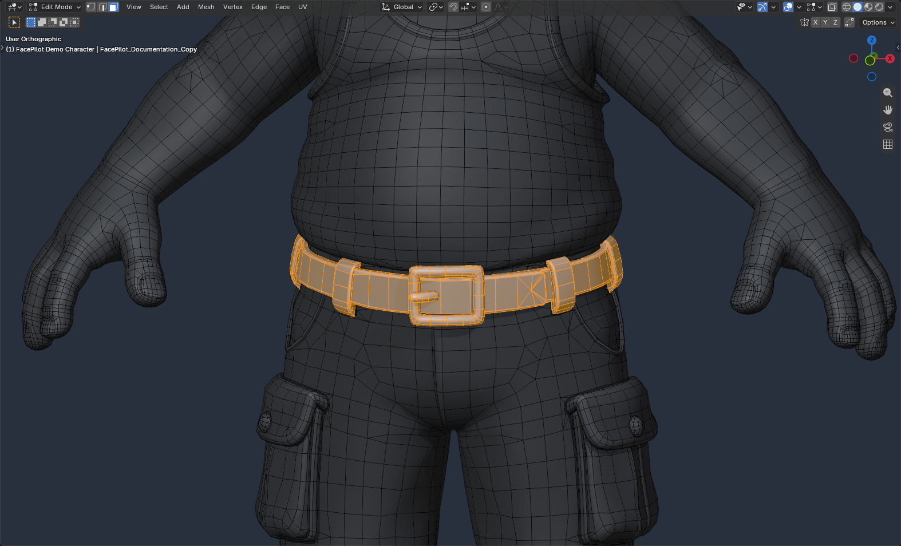

**Renkler, siyah önizleme ve kırmızı işaretler GPU ekran katmanlarıdır.** Base Color, shader düğümleri, dokular, UV'ler, vertex renkleri, yüz malzeme atamaları ve dışa aktarım verilerini değiştirmezler. Render, bake, FBX/OBJ/glTF veya Substance Painter'a gitmezler. Dosya yeniden açılınca veya eklenti kapatılınca temizlenirler. Gerçek atama ve onarım düğmeleri ise modeli değiştirir.

## 8. İnce çalışırken yalnız seçimi göster

Panelin en üstündeki **Yalıt**, seçim dışını gizler. **Geri göster**, önceden gizli olanları koruyarak eski gizlilik durumuna döner. Seçim bölümündeki **Tüm gizlileri göster**, işlem öncesinde gizlediğin yüzler dahil her şeyi açar.

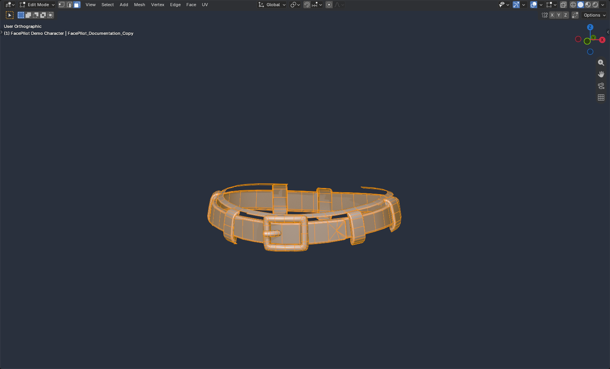

Geometri silinmez. Geri almayla uyumlu gizlilik yedeği geçici tamsayı mesh özniteliklerinde tutulur; GPU renk önizlemelerinden ayrıdır. Topolojiyi değiştirmeden önce izolasyonu geri al. Uyumsuz değişiklikten sonra eski gizlilik haritası uygulanmaz.

## 9. Olası eksik yüzleri ve açıklıkları listele

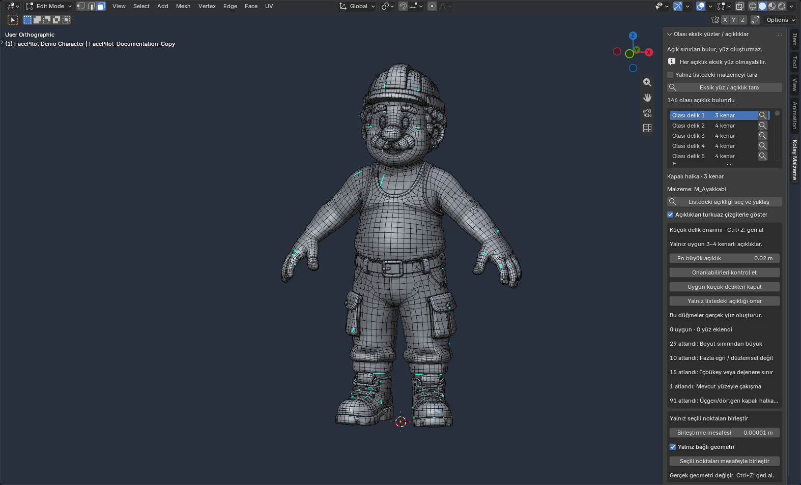

**Açıklıklar ve onarım** panelini aç:

1. **Eksik yüz / açıklık tara** düğmesine bas.
2. Kenar sayısı, kapalı halka / zincir / dal türü ve komşu malzemeleri incele.
3. Satırdaki büyüteç veya **Seç ve yaklaş** ile sınırı seçip o bölgeye yaklaş.
4. **Açıklıkları turkuaz çizgilerle göster** ile sınırları ekranda belirginleştir.
5. İstersen **Yalnız listedeki malzemeyi tara** kutusunu açıp yeniden tara.

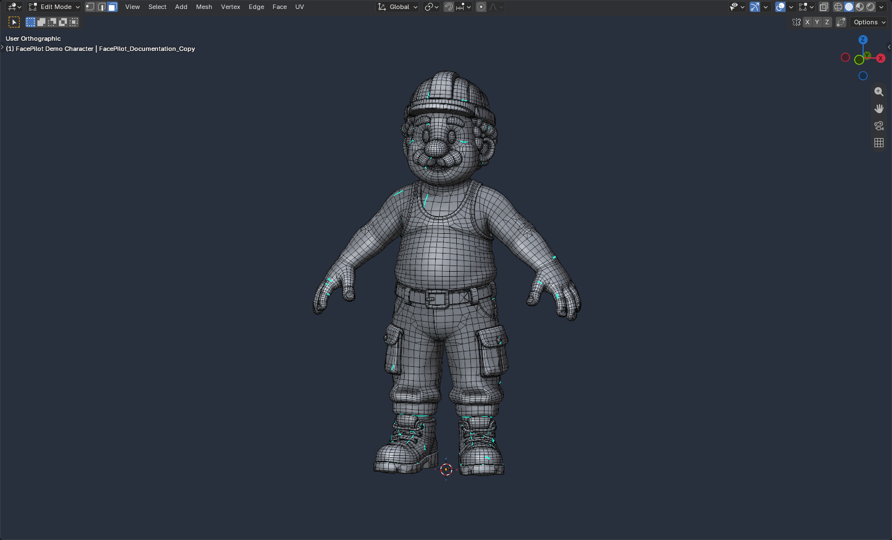

Araç, **yalnız bir yüze bağlı** kenarları bağlantılı gruplara ayırır. Kıyafet ağzı veya açık bir yüzeyin dış sınırı bilerek açık bırakılmış olabilir; listedeki her satır kesin hata değildir. Gizli yüzler topolojiye dahil edilir; yüzü gizlemek yapay delik oluşturmaz. Boş kenarlar, tamamen kayıp parçalar ve bütün non-manifold sorunlar bu taramanın kapsamı değildir. Topoloji değişince yeniden tara.

## 9.1. Önemsiz açıklıkları yoksay · 1.8 yeniliği

Listeden açıklığı seçip **Yoksay** düğmesine veya satırdaki **×** işaretine bas. Açıklık listeden ve turkuaz çizgilerden kalkar; sıkı onarıma ve yama önizlemesine dahil edilmez. Geometri, UV, malzeme ve mevcut seçim değişmez.

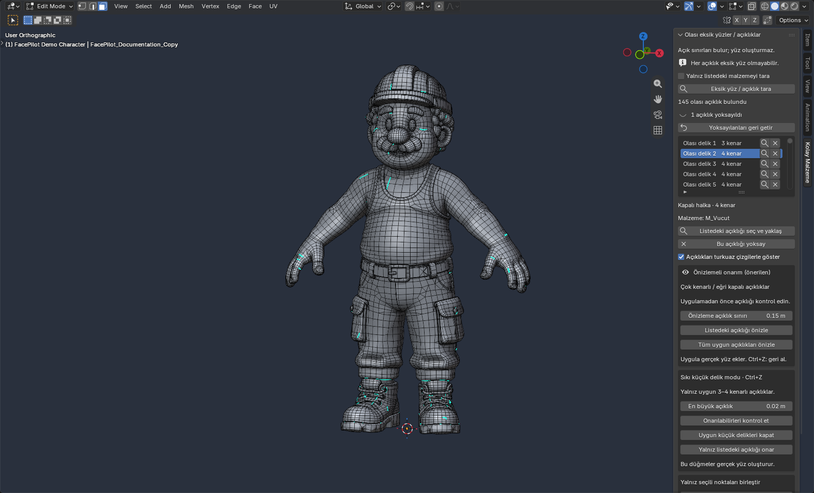

**Yoksayılanları geri getir**, bu mesh'te elediğin bütün açıklıkları geri getirir. Yeniden tarama ve malzeme filtresi değişiklikleri tercihlerini korur. Yoksayma/geri getirme mevcut mor öneriyi iptal eder; uygulamadan önce yeniden önizle. Eklentinin yaptığı onarımlarda değişmeden kalan sınırlar yoksayılmış kalır; dışarıdan topoloji değişikliği veya nokta birleştirme, eski indekslere dayalı elemeleri sıfırlar. Tercihler oturumluk tutulur; dosya yeniden açılınca veya eklenti kapatılınca temizlenir.

## 10. Onarımı uygulamadan önce önizle · 1.7 yeniliği

Tarama panelindeki **Önizlemeli onarım** bölümünü kullan:

1. Mesh'i tara, listeden açıklığı seç ve büyüteçle incele.
2. **Önizleme açıklık sınırı** ayarını kontrol et; varsayılan **0,15 dünya birimi**, varsayılan metre ölçeğinde 15 cm.
3. Tek satır için **Listedeki açıklığı önizle**, mevcut taramadakiler için **Tüm uygun açıklıkları önizle** düğmesine bas.
4. Önerilen **saydam mor üçgenleri** incele. **Yama saydamlığı** sürgüsünü ayarlayabilirsin. Panel yama/üçgen sayısını ve atlama nedenlerini gösterir; **henüz gerçek yüz eklenmez**.
5. Görünen üçgenleri gerçekten eklemek için **Uygula**, vazgeçmek için **İptal** kullan. Uygulanan onarımı **Ctrl+Z** geri alır.

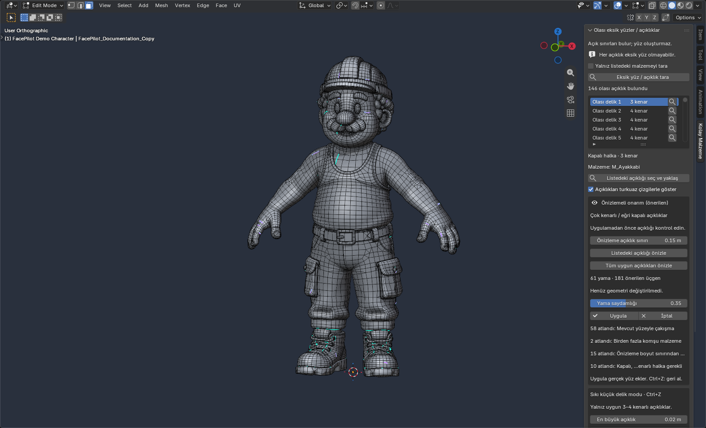

Bu mod **3–256 kenarlı kapalı halkaları**, içbükey ve eğri/düzlemsel olmayan sınırlar dahil değerlendirir. Üçgenleme kopyada hesaplanır. Komşu malzeme tek olmalı, sınır yönleri tutarlı olmalıdır. Gizli geometri, bozuk/dejenere sınırlar, mevcut yüzeyle veya önerilen başka yamayla çakışma ve başka yüzlerin kullandığı iç köşegenler reddedilir. Tasarım gereği açık bırakılmış bir yere de yama önerebilir; uygulamadan önce kontrol et.

| Kontrollü sekiz kenarlı açıklık | Mor öneri | Geçici kopyada uygulanmış hâli |
|---|---|---|
| 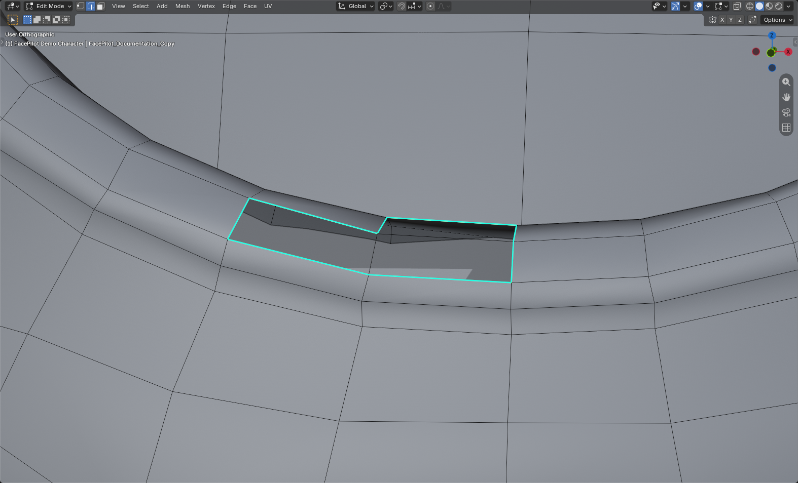 | 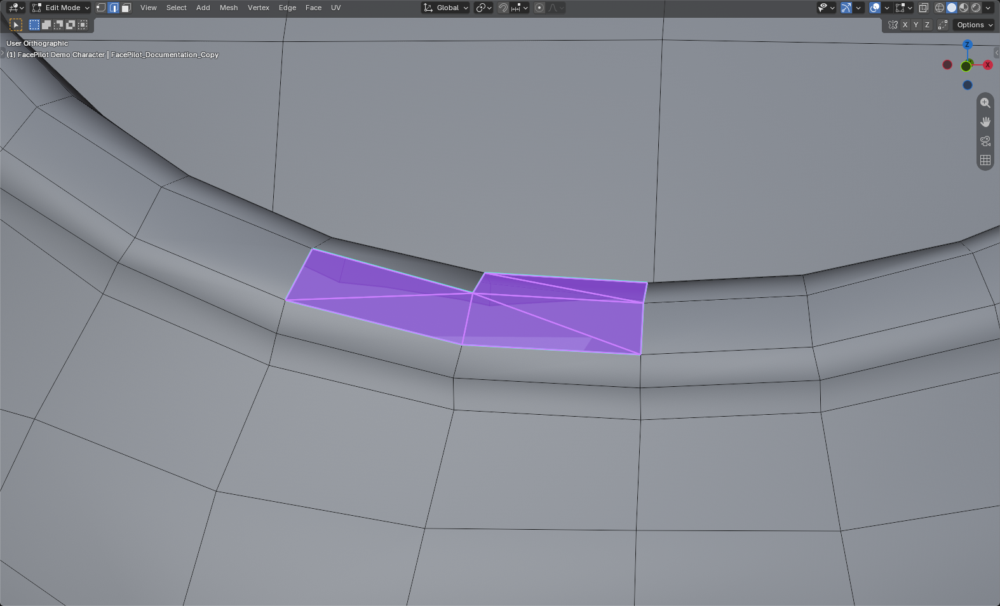 | 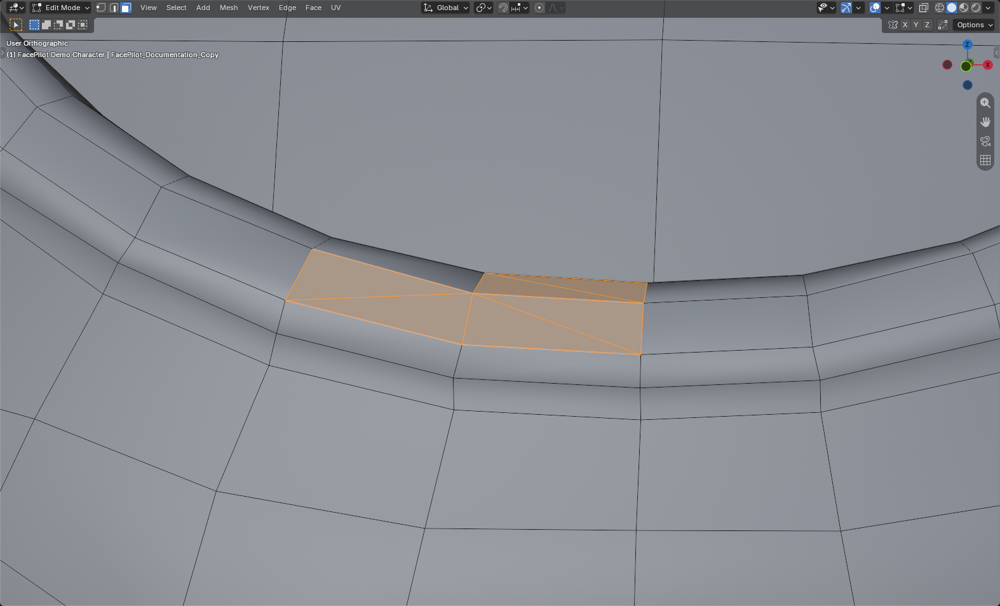 |

*Yakın çekim için kopyadaki üç komşu atlet dörtgeni bilerek silinip sekiz kenarlı açıklık oluşturuldu. Önizlemede 27.696 gerçek yüz aynı kaldı; Uygula altı üçgen ekleyip 27.702 yüze çıkardı. Bu gösterimde canlı asıl model değiştirilmedi.*

Önizleme GPU oturum verisidir; dışa aktarılmaz. Seçim ve kamera değişebilir; nokta konumu, topoloji, gizlilik, malzeme, UV veya obje dönüşümü değişirse öneri geçersiz olur. Boyut sınırını değiştirince yeniden önizle. Yeni üçgenler komşu malzemeyi ve kopyada hesaplanan UV verisini alır; **boyamadan önce yeni UV'leri kontrol et**. Araç smoothing, remesh, nokta birleştirme, otomatik unwrap veya anlamsal delik tanıma yapmaz.

## 10.1. Sıkı küçük delik modu

**Gelişmiş onarım** bölümünde **En büyük açıklık** ayarını kontrol et ve **Onarılabilirleri kontrol et** düğmesine bas. Bu kontrol geometriye dokunmadan uygun/atlanan sayısını verir. **Uygun küçük delikleri kapat**, taramadaki uygun halkaları; **Yalnız listedeki açıklığı onar**, yalnız etkin satırı işler.

Ayrı **Sıkı küçük delik modu**, önceki temkinli davranışı korur. Varsayılan boyut sınırı **0,02 dünya birimidir**; Blender'ın varsayılan metre ölçeğinde 2 cm. Yalnız görünür, dışbükey, yeterince düz **3 veya 4 kenarlı kapalı halkalar** kabul edilir. Bu bölümdeki **Onarılabilirleri kontrol et** sayısal kontroldür; yukarıdaki mor geometri önizlemesinden ayrıdır. Karışık komşu malzeme, tutarsız yüz yönü, yakındaki çok-yüzlü kenar, aşırı boyut, bozuk/eğri sınır ve mevcut yüzeyle çakışma durumları atlanır; nedenleri listelenir.

| Önce: kontrollü eksik üçgen | Sonra: bir yüz eklendi |
|---|---|
| 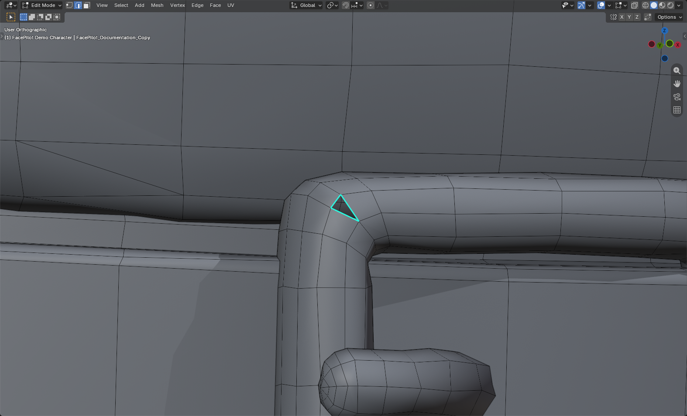 | 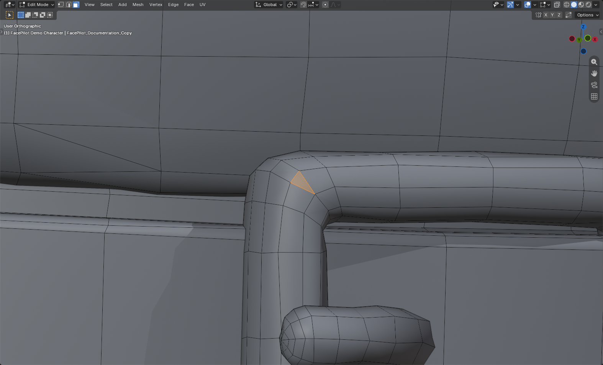 |

*Bu örnekte model kopyasındaki kemer tokasından bir üçgen bilerek çıkarıldı ve 0,04 boyut sınırıyla onarıldı. 146 olan açıklık sayısı 147'ye çıktı; bir yüz eklendikten sonra tekrar 146 oldu. Asıl karakter onarılmadı veya değiştirilmedi.*

Yeni yüz komşu malzemeyi alır, yönü komşularına göre ayarlanır. Mevcut yüzlerin UV'leri korunur; **yeni yamanın UV'sini boyamadan önce kontrol et**. Araç otomatik unwrap/retopoloji yapmaz ve tasarım gereği açık olan yeri kapatıp kapatmama kararını vermez. **Ctrl+Z** ile geri alabilirsin.

## 11. Yakın seçili noktaları birleştir

**Yalnız seçili noktaları birleştir** bölümünde amaçladığın noktaları seç, **Birleştirme mesafesi** ayarla, başlangıçta **Yalnız bağlı geometri** açık kalsın ve **Seçili noktaları mesafeyle birleştir** düğmesine bas.

Yalnız seçili, görünür noktalar işlenir. Varsayılan eşik **0,00001 dünya birimi**. Bağlantılı geometri seçeneği birleştirmeyi bağlı geometriyle sınırlar; ayrı duran çakışık noktaları birleştirmek istiyorsan bilinçli olarak kapat. Eşit olmayan obje ölçeğinde yerel eşik temkinli küçültülür; bazı yakın çiftler birleşmeden kalabilir. **Ctrl+Z** geri alır.

Nokta birleştirmek ile eksik yüz kapatmak ayrı işlerdir. Birleştirme, doğru yüz oluştuğunu, iyi edge flow'u veya doğru UV'yi garanti etmez. Her gerçek geometri işleminden sonra bölgeyi kontrol et.

## Sorun giderme

| Durum | Kontrol et |
|---|---|
| Düğmeler kullanılamıyor | Tek mesh seçip Düzenleme Modu'na geç; çoklu obje düzenleme desteklenmez. |
| Ctrl farklı davranıyor | İşin bitince **Ctrl ile kırmızı işaretle** kutusunu kapat. |
| Yüz kırmızı işaretlenmiyor | İlk işaretlemede yüz görünür ve turuncu seçili olmalı. |
| Onarılabilir delik yok | Atlama nedenlerini oku; açıklık büyük, düzensiz veya bilerek bırakılmış olabilir. Boyut sınırını körlemesine büyütme. |
| Hafıza/liste/işaretler temizlendi | Topoloji, mesh veya oturum değişmiş olabilir. Yeniden tara/seç. |
| Renk seçiciyi değiştirdim ama olmadı | **Bu malzemeye renk ver** düğmesine yeniden bas. |
| Önizleme renkleri görünmüyor | Siyah önizlemeyi kapat, gerekiyorsa izolasyondan çık, temel mesh'i incele. |
| Modifier yüzeyinde kaplama farklı | Önizleme temel düzenleme mesh'ini izler; geometri değiştiren modifier sonucu farklı olabilir. |
| Çıkardım ama malzemesi aynı | Seçim atamayı değiştirmez. Gerçek atama/taşıma düğmesini kullan. |

## Testler ve dosyalar

Blender 5.2.3 arka plan testinde **71 testin 70'i geçti, yalnız GUI gerektiren 1 test atlandı**. Seçim, atama ve geri alma, önizlemenin dışa aktarım verilerini koruması, kırmızı işaretler, gizleme/undo, tarama, onarımda malzeme/normal/UV ve birleştirme geri alması denetlenir. Komut ve kapsam için [geliştirme rehberine](docs/DEVELOPMENT.md) bak.

```text
kolay_malzeme_tr.py         Eklenti kaynağı; sabit modül adı
dist/FacePilot-1.11.0.zip    Kurulabilir tek dosyalı eklenti
README.md / README.tr.md   Tam İngilizce / Türkçe rehberler
docs/images/              Gerçek Blender ekran görüntüleri
docs/brand/               FacePilot logo dosyaları
tests/test_addon.py        Geçici Blender test modelleri
```

Ekran görüntüleri kullanıcının karakterinin geçici kopyasından, ayrı Blender oturumunda alındı. Kaynak karakter `.blend` dosyası ve dokuları dağıtılmaz. FacePilot banner'ı üretilmiş marka görselidir; Blender ekran görüntüsü değildir. [Görsel notları](docs/SCREENSHOTS.md) ve [sürüm geçmişi](CHANGELOG.md) repoda bulunur.
