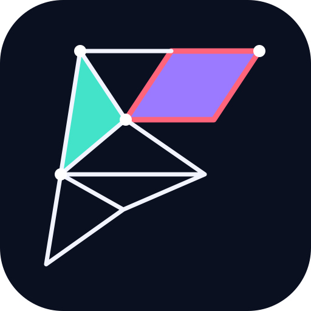

# FacePilot identity / Marka kimliği

**FacePilot** combines face-level mesh control with a navigation metaphor: choose a region, separate it visually, and make an explicit correction. The geometric F/arrow uses connected vertices and selected polygon faces.

**FacePilot**, yüz düzeyinde mesh kontrolünü yön bulma fikriyle birleştirir: bölgeyi seç, görsel olarak ayır, düzeltmeyi bilinçli uygula. Geometrik F/ok işareti bağlı noktalar ve seçili çokgenlerden oluşur.

| Color | Hex | Role / Kullanım |
|---|---|---|
| Ink | `#0B1020` | Background / Zemin |
| Cyan | `#43E3CA` | Selection and clarity / Seçim ve netlik |
| Violet | `#9B7AFF` | Material differentiation / Malzeme ayrımı |
| Coral | `#FF647B` | Correction accent / Düzeltme vurgusu |
| Ice | `#F2F5FF` | Mesh edges and type / Kenarlar ve yazı |

- [Hero banner / Kapak](facepilot-banner.png): generated brand artwork with the wordmark and tagline.
- [Vector mark / Vektör işaret](facepilot-mark.svg): editable, scalable companion asset built from polygon paths.

Tagline: **SELECT. SEPARATE. SEE CLEARLY.** / **Seç. Ayır. Net gör.**
